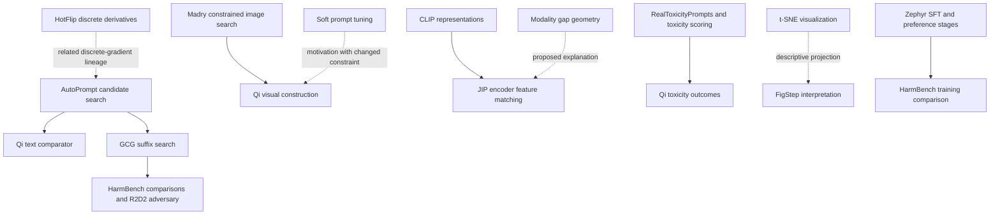
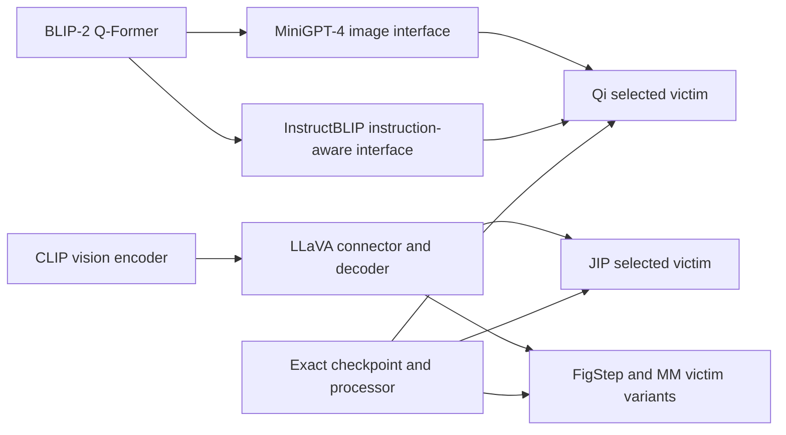

# Reference dependency audit

30 October 2026. Standing requirement for the current five-paper collection, all later batches and our manuscript evidence review.

The audit traces **what a paper inherits, what it changes, and which claims depend on the inherited evidence**. The complete first reference layer is catalogued: **343 bibliography entries**, grouped into **253 works/resources**, including **56 groups cited by more than one of the five papers**. Relevant primary passages were inspected for **18 upstream works**; **235 groups remain unreviewed in this upstream audit**. These are deliberately separate completion states. The original five-paper reviews remain available in [FIVE_PAPER_EVIDENCE_REVIEW.md](FIVE_PAPER_EVIDENCE_REVIEW.md).

Every direct bibliography entry is retained in the [CSV register](../reports/reference_dependency_catalogue.csv) and [structured catalogue](../reports/reference_dependency_catalogue.json), with its parent version, reference label, title/authors as cited, source link, in-text citation locations, provisional role and reading status. The [evidence explorer](../presentation/Five_Paper_Evidence_Explorer.html) adds searchable reference browsing and a graph of which parent papers cite a selected work. Bibliographic grouping does not establish identical versions, implementations or uses.

**Training-free follow-up.** A separate [nine-paper bibliography](../reports/training_free_reference_dependencies.csv) retains 463 direct entries. The [four-method study](TRAINING_FREE_SAFETY_RESEARCH.md#critical-reference-chains) traces the critical benchmark, scorer, checkpoint and method dependencies for MARS, ShiftDC, ECSO and CMRM. These totals are separate from the original five-paper audit.

## 1 Scope and honest completion

| Parent paper | Checked version | Bibliography entries | First-layer extraction |
|---|---|---:|---|
| Qi | 2306.13213v2 | 84 | Complete against versioned HTML bibliography |
| Jailbreak in Pieces | 2307.14539v2 | 44 | Complete against versioned HTML bibliography |
| FigStep | 2311.05608v3 | 65 | Complete against versioned HTML bibliography |
| MM-SafetyBench | 2311.17600v5 | 52 | Complete against versioned HTML bibliography |
| HarmBench | 2402.04249v2 | 98 | Complete against versioned HTML bibliography |
| Total | Five fixed versions | 343 | All entries retained, including duplicate citations |

“Complete” in this table means bibliography extraction only. It does not mean all cited originals were opened, all dependency roles validated or all experiments reproduced. Website/software/policy entries are kept rather than mislabelled as papers. URLs and arXiv identifiers reported by a citing paper remain **as cited** until independently checked. Empty or ambiguous identity fields remain unresolved.

The 253 groups use exact normalized titles and explicit arXiv identifiers, preserving all original spellings and source-specific entries. Normalization ignores punctuation and terminal year labels; it is an identity aid, not proof that publication versions are equivalent. No approximate title-similarity merge is used. Similar titles can be different papers: *Generating Natural Adversarial Examples* and *Generating Natural Language Adversarial Examples* remain separate. A repeated entry in one parent's bibliography is retained even when it maps to one work group.

The audit's **18 primary-source checks are scoped readings**, not eighteen complete standalone reviews. Twenty-three selected primary resources were retrieved privately; retrieval alone does not count as review. The relevant source passages, checksums and scope are recorded for the eighteen reviewed dependencies. Existing review knowledge of the five roots does not automatically promote all their cited works to “read.”

The first layer is the five roots' complete bibliographies. Further technical chains are explained selectively below. Their entire bibliographies have not yet been recursively catalogued. References appearing only through footnotes, software installation files or an acknowledgement outside the formal bibliography require supplemental discovery when material; first-layer completeness does not assert that those surfaces are exhausted.

## 2 Standing procedure for every future batch

1. Freeze root-paper versions and inspect the original bibliography. Preserve every entry and in-text locator; distinguish papers, books, software, data, policies and other resources.
2. Link shared works without discarding duplicate citation labels or version differences. Carry the register across batches rather than creating disconnected reading lists.
3. Read citation context before deciding its role. A title-based or section-based suggestion is provisional. Acknowledgement of funding, colleagues or infrastructure is not automatically a method dependency.
4. For material dependencies, open the original method, relevant tests and limitations. Record exactly what was inspected. Distinguish an original algorithm from a later implementation or model checkpoint.
5. Write the inheritance chain: **upstream contribution → downstream use/change → dependent claim → inherited limitation → unresolved check**.
6. Follow necessary earlier dependencies recursively. Stop at an explicitly understood primitive, an inspected resource boundary, or a documented unresolved dependency. Never imply that the whole ancestor literature has been verified.
7. Audit how a weaker or invalid upstream assumption would change the downstream conclusion. A weak judge can weaken outcome validity; an inaccessible training corpus may limit provenance without invalidating every observed response.
8. Update source depth, role, version, artifact and empirical-validation states independently. Reading or downloading is not reproduction.

This procedure is now recorded in [AGENTS.md](../AGENTS.md) and [Section N of the research brief](NOTEBOOKLM_VLM_RESEARCH_BRIEF.md#n-required-reference-dependency-audit-for-every-paper-and-manuscript). It is a project evidence standard, not a claim that every venue requires this exact checklist.

### Depth and priority definitions

| Level | Use in the citing paper | Required work |
|---|---|---|
| Critical construction dependency | Algorithm, objective, optimizer or architecture actually used | Inspect native definition and actual adaptation; resolve implementation identity before claiming fidelity |
| Critical measurement dependency | Dataset, label rubric, evaluator or utility score supporting a result | Inspect construction, selection, metric and validation limitations |
| Critical comparison dependency | Closest predecessor, baseline or novelty comparator | Inspect original scope and downstream comparison settings/budget |
| Supporting interpretation | A theory or observation used to explain results | Check whether it actually establishes the claimed inference |
| Background | Contextual history or adjacent work | Verify identity and relevant claim; deepen if it becomes material |
| Acknowledgement or infrastructure | Funding, discussion, software/service credit | Preserve provenance; investigate technically only when it affects the evidence |

Priority is claim-specific. The same CLIP citation can be background in one passage and a technical prerequisite in another. A theory cited to motivate an experiment need not be sufficient evidence for its mechanistic conclusion. Shared citation counts determine neither scientific importance nor validity.

## 3 The main inheritance chains

Solid arrows denote inherited components or data use established in the inspected roots. Dashed arrows denote motivation or interpretation; they do not assert causal proof. The register separately records citation edges, which can be broader than these technical chains.

Architecture-family papers explain a design, but an experiment still needs the actual checkpoint, processor, connector and template. “Uses CLIP” does not mean every downstream system consumes the same feature tensor. Original model training is literature background; none was executed for this audit.

## 4 Dependency cards and checks performed

### A Constrained optimization from Madry

**Original:** [Madry et al., 1706.06083v4](https://arxiv.org/html/1706.06083v4), Sections 2.1, 3 and 5. The source separates an inner input attack from an outer weight-training objective and tests MNIST/CIFAR robustness under specified threat sets. **Downstream:** Qi cites it as reference 49 for PGD image construction; FigStep reference 29 and HarmBench reference 59 also cite the work in their own contexts. The latter citations must not be assumed to have precisely the same operational role as Qi's.

**Inheritance audit:** the constraint/projection idea transfers; the optimized loss and output event change. Minimizing harmful-corpus likelihood loss is not maximizing classifier true-label loss. The inherited mathematical machinery therefore does not transfer classifier accuracy results or robust-training conclusions. Required closure for a native implementation is the exact coordinate domain, gradient sign, projection, initialization, budget and objective reduction. This check concerns relevant source passages, not every theorem or attack setting.

### B HotFlip to AutoPrompt to GCG

**Original sources:** [Ebrahimi et al., HotFlip](https://aclanthology.org/P18-2006.pdf), Section 3.2/Equation 1; [Shin et al., AutoPrompt, 2010.15980v2](https://arxiv.org/html/2010.15980v2), Sections 2.2 and 7; [Zou et al., GCG, 2307.15043v2](https://arxiv.org/html/2307.15043v2), Sections 2.2–2.3 and 3. HotFlip uses directional derivatives to rank discrete changes. AutoPrompt proposes candidates using gradients, then evaluates them exactly. GCG modifies the search for generative suffix objectives and shared attacks.

**Downstream:** Qi references 23/68 underpin its discrete text comparator. HarmBench references 28/78/98 support method lineage and implemented baselines; GCG also supplies its R2D2 adversary. **What changed:** classifier or masked-LM probing becomes sequence-generation optimization; candidate selection, shared contexts and evaluation change. A count of iterations is not a complete budget comparison because candidate forward passes differ.

**Inherited limitations:** local surrogate gradients guide search but do not certify global success. An affirmative-prefix objective can be a construction surrogate; it is not a complete harmful-behavior judgment. GCG v2 describes 500 strings and 500 behaviors in its experimental framing, while JIP quotes other AdvBench counts. Resolve release/version and selected manifests rather than silently choosing one number. These checks do not establish identity between every original and HarmBench-reimplemented baseline.

AutoPrompt explicitly builds on Wallace et al.'s *Universal Adversarial Triggers* in its Section 2.2. That predecessor is catalogued but its original has not been passage-reviewed in this audit. The full recursive discrete-search chain is therefore still open; the dashed diagram link must not be read as proof of a direct HotFlip-to-AutoPrompt citation dependency.

### C Soft prompt tuning and Qi's conditioning analogy

**Original:** [Lester, Al-Rfou and Constant, The Power of Scale for Parameter-Efficient Prompt Tuning](https://aclanthology.org/2021.emnlp-main.243.pdf), Section 2. The study learns continuous prompt parameters while the base language model stays fixed. **Downstream:** Qi reference 44 motivates treating an optimized image as conditioning that influences a frozen model.

**Audit:** this is a useful objective-level analogy, with a material constraint change. Soft prompts are free learned embedding parameters; an image must pass through the image processor and vision pathway. Not every embedding can be reached by a bounded image. The analogy does not prove a persistent parameter-level removal of alignment. Model-scale or task results from the prompt-tuning paper are not Qi jailbreak results. Inspecting this dependency clarifies the difference between input optimization and victim-weight training.

### D CLIP representations and JIP

**Original:** [Radford et al., CLIP, 2103.00020v1](https://arxiv.org/html/2103.00020v1), Sections 2.2–2.4 and 6. The source trains image/text encoders with a contrastive pairing objective and studies zero-shot transfer. Its large-scale web image/text construction and reported limitations are relevant to what “shared semantic space” means. **Downstream:** direct CLIP references appear in Qi 63, JIP 34 and FigStep 42. JIP additionally references a specific CLIP model resource separately.

**Audit:** JIP targets an encoder representation and then observes a downstream VLM. Contrastive pairing does not imply that matching one pooled embedding reproduces all intermediate tokens supplied to a connector. Processor, resolution, normalization and extraction layer are therefore critical dependencies. The original CLIP limitations include abstract/systematic tasks and distribution shift; they qualify assumptions about trigger meaning or OCR. They do not directly establish a safety-jailbreak mechanism or certify visual equivalence after artifact compression.

### E Modality gap as an explanation rather than a behavioral proof

**Original:** [Liang et al., Mind the Gap, 2203.02053v2](https://arxiv.org/html/2203.02053v2), Sections 2–4. The authors examine modality separation, initialization/cone effects and contrastive learning, including representation-shift experiments. **Downstream:** JIP's Liang et al. citation (bibliography entry 20) helps interpret why targeting CLIP text features works differently from targeting image features.

**Audit:** the geometric phenomenon supplies a plausible explanation. It does not itself test JIP's complete image→connector→decoder→harm chain. A lower text-target ASR could also depend on preprocessing, reachable feature regions or decoder behavior. Treat the causal account as an interpretation unless the downstream study isolates it. The requirement is to distinguish the original geometric evidence from the newer behavioral inference.

### F Adam and the JIP algorithm description

**Original:** [Kingma and Ba, Adam, 1412.6980v9](https://arxiv.org/pdf/1412.6980v9), Algorithm 1 and Section 2. Adam maintains first/second moment estimates and bias correction. **Downstream:** JIP cites it (bibliography entry 17) and names Adam, while its displayed image update is schematic gradient descent.

**Audit:** those are not fully interchangeable optimizer definitions. The actual released optimizer state and settings determine the executed trajectory. Adam's illustrative defaults do not authorize filling missing JIP hyperparameters. Its convergence discussion under its own assumptions does not prove convergence of the nonconvex image attack or establish a behavioral jailbreak. The paper/release distinction remains part of the original JIP audit.

### G BLIP-2 to MiniGPT-4 and InstructBLIP

**Original:** [Li et al., BLIP-2, 2301.12597v3](https://arxiv.org/html/2301.12597v3), Section 3. A Q-Former bridges frozen unimodal models through two pretraining stages. **Downstream sources inspected:** [Zhu et al., MiniGPT-4, 2304.10592v2](https://arxiv.org/html/2304.10592v2), Section 3 and limitation analysis; [Dai et al., InstructBLIP, 2305.06500v2](https://arxiv.org/html/2305.06500v2), Sections 2.3 and 2.6. MiniGPT-4 uses a pretrained vision/Q-Former path with a projection into Vicuna; InstructBLIP makes feature extraction instruction-aware.

**Audit:** neither system should be represented as a universal single CLIP vector followed by an identical linear connector. For InstructBLIP, the accompanying text can affect extracted visual features. This matters to any claim that an image has an invariant representation across requests. Original hallucination/perception limitations also affect interpretation of low attack ASR. A model-family paper remains insufficient to identify the exact checkpoint and feature pathway of a later attack study. MiniGPT-4 is a direct reference of four roots; BLIP-2 is also an important selectively followed ancestor even where a root does not cite it directly.

### H LLaVA and the danger of inheriting only a model name

**Original:** [Liu et al., Visual Instruction Tuning, 2304.08485v2](https://arxiv.org/html/2304.08485v2), Sections 4.1–4.2. The paper specifies a vision/language connector and staged feature alignment/instruction tuning. It is the one normalized work group cited by **all five roots** in this catalogue.

**Audit:** sharing this citation does not make the five experimental victims identical. Qi explicitly freezes its LLaMA-2-Chat backbone in a modified implementation; FigStep/MM/HarmBench also cite the later *Improved Baselines with Visual Instruction Tuning* and evaluate LLaVA-1.5 variants. That later paper is catalogued/retrieved but not counted among the eighteen upstream passage reviews here. Version/checkpoint/processor recovery therefore remains open. The inherited architecture supports the existence of a visual interface, not identical safety behavior or a cross-paper numerical ranking.

### I LLaMA-Adapter V2 and lower ASR

**Original:** [Gao et al., LLaMA-Adapter V2](https://arxiv.org/pdf/2304.15010), architecture/early-fusion passages. The source discusses early visual fusion, separate parameter groups and optional expert models. **Downstream:** JIP bibliography entry 9 supplies one victim family; MM-SafetyBench reference 16 also identifies it.

**Audit:** the relevant dependency is the deployed configuration, including whether optional experts are present. Lower harmful-output ASR may reflect weaker visual understanding or instruction following, as JIP itself cautions. Original architecture capabilities cannot substitute for comprehension measurements in the attack setting. A source-family description and later checkpoint identity are separate requirements. The downloaded source's exact version must be resolved before claiming version equivalence to the citing study.

### J RealToxicityPrompts and the selected challenge population

**Original:** [Gehman et al., RealToxicityPrompts, 2009.11462v2](https://arxiv.org/html/2009.11462v2), Sections 2.2, 4.1 and 5.3. The larger dataset comes from stratified web-text selection and sentence splitting. Its 1,225 challenging prompts are selected through toxic-generation behavior of the tested original models.

**Downstream:** Qi reference 28 uses that challenge subset. **Audit:** this is a selected difficult continuation population, not a randomly sampled set of harmful instructions. The source's expected-maximum and any-of-25 metrics must not be silently inherited by Qi's attribute-threshold output rates. The original discussion of toxicity-detector biases also qualifies downstream Perspective-based conclusions. Toxicity threshold crossing does not establish fulfillment of a particular harmful request. Source subset provenance is reviewed; exact historical scorer revisions remain unresolved.

### K DiffPure in a new task

**Original:** [Nie et al., Diffusion Models for Adversarial Purification](https://arxiv.org/pdf/2205.07460), method and adaptive-evaluation passages. It adds diffusion noise and reverses the process, testing image-classifier robustness including adaptive attack considerations. **Downstream:** Qi reference 53 applies purification and reports toxicity changes.

**Audit:** the preprocessing idea transfers; the model/task/outcome do not. Purification can change useful visual information as well as an adversarial perturbation. Lower toxicity on the tested Qi artifacts establishes that measured intervention in that setting. It does not inherit all classifier robustness results, demonstrate full VLM utility preservation or establish resistance to an attacker optimizing through purification. The retrieved unversioned PDF must be version-matched before an exact artifact comparison.

### L t-SNE and FigStep's mechanistic interpretation

**Original:** [van der Maaten and Hinton, Visualizing Data using t-SNE](https://www.jmlr.org/papers/volume9/vandermaaten08a/vandermaaten08a.pdf), method, perplexity and nonconvexity discussion. The algorithm constructs a low-dimensional visualization; local similarity and optimization choices determine the display.

**Downstream:** FigStep reference 50 supports the visualization in Section 6.5/Figure 5. **Audit:** visible separation or overlap can motivate further analysis but does not identify a causal safety mechanism. The original source's information-loss/nonconvexity limitations carry forward. To support a stronger mechanism claim, the downstream study would need additional interventions or measurements beyond a two-dimensional plot. No such intervention was performed for this audit.

### M MT-Bench and Zephyr in HarmBench's utility argument

**Original sources:** [Zheng et al., Judging LLM-as-a-Judge, 2306.05685v4](https://arxiv.org/html/2306.05685v4), Sections 3.3–3.4/Appendix D.1; [Tunstall et al., Zephyr, 2310.16944v1](https://arxiv.org/html/2310.16944v1), Sections 3 and 4.2–4.3. The first examines chat evaluation and judge biases; the second uses supervised distillation and preference optimization as distinct stages.

**Downstream audit:** HarmBench's R2D2 utility comparison uses MT-Bench and a Zephyr-related training codebase, but its Table 11 caption says the R2D2 experiment does not include the same DPO stage as Zephyr Beta. Thus a utility-score difference cannot be attributed solely to adversarial training under an otherwise identical pipeline. Judge biases qualify interpretation of the utility score, which remains different from ASR. Important bibliographic finding: *Judging LLM-as-a-Judge* is directly listed in FigStep (reference 62), whereas HarmBench's text names MT-Bench without a matching bibliography entry for that paper. Its role in HarmBench is therefore a **text-mentioned measurement dependency**, not an invented direct bibliography citation. Further DPO/UltraChat/Mistral dependency review remains open.

## 5 Root-specific dependency closure map

| Root | Critical inherited components | Evidence currently checked | Remaining requirements before treating the chain as closed |
|---|---|---|---|
| Qi | PGD; prompt conditioning analogy; discrete comparator; victim architectures; RTP/toxicity; purification | Relevant original passages for PGD, prompt tuning, AutoPrompt/HotFlip, CLIP, MiniGPT-4, LLaVA, InstructBLIP, RTP, DiffPure | Exact victim revisions; corpus/Anthropic selection lineage; Detoxify/Perspective/moderation versions; prompt-tuning implementation boundary; full text-comparator budget |
| JIP | Encoder/feature choice; CLIP resource; Adam; modality-gap interpretation; victim configurations; toxicity labels | CLIP, Adam, gap study, LLaVA and Adapter relevant passages | Exact feature extraction/normalization; delivered-file parity; complete trigger manifest; optional victim experts; scorer validation and reviewer reconciliation |
| FigStep | Victim families; policy question construction; GPT-assisted paraphrase; comparators; t-SNE; manual/AI scoring; OCR | Shared architecture sources, GCG lineage, t-SNE and source result/control map | LLaVA-1.5/EVA/CogVLM originals and exact checkpoints; EasyJailbreak comparator implementations; GPT-4/AI rubric provenance; historical policies and EasyOCR/moderation configuration |
| MM-SafetyBench | Policy scenarios; GPT-4 generation/filtering/scoring; SDXL; model panel; protector comparison | Root construction/rubric plus selected shared victim-source passages | Historical policy versions and GPT-4 evaluator identity; SDXL configuration; all twelve victim details; MLLM-Protector training/comparison source; query-field release mismatch |
| HarmBench | GCG/discrete lineage; PGD/patch; classifier distillation; model families; Zephyr/UltraChat/Mistral; utility evaluation | GCG/AutoPrompt/HotFlip, PGD, CLIP-related boundary, Zephyr and MT-Bench relevant passages; root classifier/split rules | Patch original and exact multimodal configs; all adapted baseline settings; GPT-4 teacher/annotation detail; training-data lineage; classifier-code parity; DPO/Mistral/UltraChat review and service-filter boundaries |

The checked sources support specific inheritance assessments, not a blanket closed status. Pending rows can affect different claims differently. For example, a missing historical API version limits exact reproducibility; an unvalidated judge may weaken the behavioral outcome itself. A remaining critical dependency must be tied to the affected claim rather than declared a universal defect.

## 6 Manuscript requirement and evidence gates

The owner has made this audit a requirement for **our paper-writing process**. It applies before a claim is treated as supported or a contribution described as novel. It does not prohibit drafting with visible placeholders, and it does not claim that publication requires reading every reference's entire ancestry.

| Gate | Required evidence | Current five-paper layer |
|---|---|---|
| Bibliography coverage | Every direct entry accounted for; root version fixed | Complete for 343 entries across the selected versions |
| Identity and role | Original identity/version checked for material items; actual citation use recorded | Partial: eighteen selected originals inspected; remaining roles provisional |
| Technical inheritance | Native definition and downstream changes documented | Selected method/architecture chains reviewed; further closure pending |
| Data and measurement | Provenance, splits, success rubric, judge validity and utility boundaries | Root protocols mapped; several upstream services/artifacts remain open |
| Comparisons and novelty | Closest predecessors read; intervention/budget/metric differences checked | Unresolved overall; citation coverage is not a novelty conclusion |
| Claim sensitivity | State which conclusion changes if a dependency fails | Qualitative sensitivity map above; manuscript-specific claim IDs still needed |
| Empirical support | Published findings separated from our measured/validated results | No upstream experiment reproduced by this audit |

For each manuscript claim, record: **claim ID → root evidence → upstream dependency → version/source location → actual adaptation → critical assumption → supporting/counterevidence → unresolved check → allowed wording**. A result inherited from a paper must be attributed to its authors. A selected upstream passage cannot support a claim that the entire predecessor literature was exhaustively verified.

Ready wording can remain narrow: “The authors report this behavior under their specified protocol.” Stronger statements such as “this mechanism explains the effect,” “this defense is robust,” or “this contribution is novel” require the relevant additional evidence. Do not infer a mechanism from an embedding plot, an implementation from a citation name, or validated safety from a model card.

## 7 Next-depth queue and stop rule

The first-layer catalogue is complete and reusable. The next depth should prioritize unresolved dependencies needed for a specific claim: scorer and policy lineage; exact victim/processor identities; comparison implementations and budgets; nearest-prior-work experiments; then mechanism assumptions. The 56 shared groups are navigation aids, not automatic priorities.

Keep critical chains open when an original is inaccessible or insufficiently specified; document what would resolve them. Stop recursion when the needed proposition is supported by an inspected source within the declared scope, or record an explicit unresolved boundary. Do not turn “all direct references catalogued” into “all papers understood.” Future batches must run the same process and update these states before claiming completion.

No model training, attack generation, judge inference, paid-resource use, public data release or manuscript submission was authorized or performed by this audit. Original papers may contain training; that remains part of literature study.

## 8 Steer2Edit first layer, 11 November 2026

New root for the weight-editing direction: **Steer2Edit** (arXiv 2602.09870, **v4** of 8 November
2026, accepted to NeurIPS 2026), with official code pinned at commit
`86382c2f44fdfda2bafe80faf09634e6d729562c`. Full study in
[the deep study](STEER2EDIT_DEEP_STUDY_AND_CONTRACT.md); the register is
[reports/steer2edit_reference_inventory.csv](../reports/steer2edit_reference_inventory.csv).
Totals here are separate from the five-paper and nine-paper audits above.

| Parent paper | Checked version | Bibliography entries | First-layer extraction |
|---|---|---:|---|
| Steer2Edit | 2602.09870v4 | 37 | Complete against versioned HTML bibliography (`ltx_bibitem` count verified) |
| Steer2Edit | 2602.09870v1 | 26 | Counted for the version diff only |

Eleven entries were added between v1 and v4, alongside Appendices H–Q. Extraction is complete;
**no cited original was read in this session**, so every role below is provisional on the citing
paper's own use, and identity is "entry parsed", not "arXiv record opened".

| Role | Count | Examples and actual use |
|---|---:|---|
| Critical construction | 6 | RepEngineering (Zou 2023a), CAA (Panickssery 2023), ODESteer (Zhao 2026) as steering baselines; AlphaEdit (Fang 2024), ASC (Azizi 2025), fine-grained steering (Feng 2026) as appendix baselines |
| Critical measurement | 17 | GCG/AdvBench (Zou 2023b), ADV-LLM (Sun 2025a), OR-Bench (Cui 2024), DREAM-7B (Ye 2025), **plus 13 uncited-but-used resources** |
| Supporting interpretation | 17 | Arditi 2024 single-direction refusal; ROME/MEMIT editing lineage; safety-head and safety-neuron localization claims |
| Background | 10 | Concept-bottleneck and agent/reasoning context |

### 8.1 Thirteen measurement dependencies used without bibliography entries

The material audit finding. Each of these is load-bearing for a published number yet has **no
bibliography entry in v4**; several are named in prose or exist only as a code path. Verified by
counting bracketed citations next to each benchmark name in the v4 text: GSM8K appears 24 times,
CodeMMLU 10, TruthfulQA 10, CommonsenseQA 8, AdvBench 4 — **none with an accompanying citation**.

- **Probing data:** MaliciousInstruct (`data/MaliciousInstruct.txt`, 100 prompts) and Alpaca
  (`data/benign_instructions.jsonl`, 100). Appendix D instead says probing uses ADVBench, which the
  code does not do; see discrepancy D2 in the deep study.
- **Utility benchmarks:** GSM8K (`skrishna/gsm8k_only_answer`), CommonsenseQA (`tau/commonsense_qa`),
  CodeMMLU (`Fsoft-AIC/CodeMMLU`, `code_completion`). These three define every "Avg Utility" cell.
- **Attribute benchmarks:** TruthfulQA, MATH-500, GPQA.
- **Evaluators:** QwQ-32B, which *defines* the truthfulness positive and negative sets, and
  Claude Opus 4.6 in the Table 16 judge-agreement study.
- **Checkpoints:** `meta-llama/Llama-2-7b-chat-hf`, `mistralai/Mistral-7B-Instruct-v0.2` and
  `Qwen2.5-VL-7B-Instruct`, all as bare repo IDs with **no pinned revision** (D10).

Consequence for our wording: a claim of the form "Steer2Edit improves safety at matched utility"
inherits a utility definition whose three datasets are not cited and whose splits are recoverable
only from `utils.py:DATASET_MAP`. We cite the code path, not the paper, for dataset identity, and we
pin our own checkpoint revision.

### 8.2 Inheritance for our own work

Steer2Edit **inherits** the mean-difference steering-vector construction from the
RepEngineering/CAA lineage and the rank-1 weight-update idea from the ROME/MEMIT editing lineage.
It **changes** the target of that update: instead of one localized factual edit or a global
inference-time shift, the steering vector becomes a *diagnostic score* that allocates a sparse
Elastic-Net budget across every attention head and MLP neuron.

Two chains must stay open until the reproduction returns a number. (i) The **refusal-metric chain**:
the native safety endpoint is a 32-string keyword list in `utils.py`, not a validated judge, so
every published safety percentage is a refusal-shaped-text rate. (ii) The **direction-provenance
chain**: the positive set is unfiltered model output (D3), so "refusal direction" is an
interpretation of what LLaMA-2-7B-Chat happened to emit under a safety system prompt.

**Stop rule applied here.** Recursion stops at this first layer except for the four critical
measurement dependencies that our own reproduction executes — AdvBench/GCG, ADV-LLM, the three
utility datasets, and the keyword refusal list — which were resolved directly from released
artifacts rather than from their originals. Those originals remain unread, and no claim in our
manuscript may assert their validity. Nothing in this extension authorized any run.
