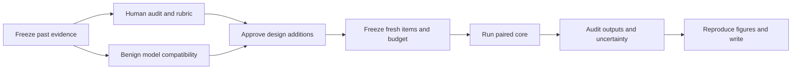

# From exploratory results to a publishable VLM safety paper

Evidence review: 2026-10-18. This is the current explanation and work plan, not a claim that the paper is ready. Scientific numbers come from saved aggregate files. Model recommendations are proposals and do not amend the approved experiment.

## 1. The question in ordinary language

Imagine asking a model the same thing in two ways: typed into a chat, or printed in a picture. If it behaves differently, it is tempting to blame its vision system. But the picture version often also changes the wording, shortens the request, and asks the model to complete a list. We need to find out which change matters.

**How much of an apparent image-related safety failure survives when the text, surrounding instruction, image presence, and scoring are controlled?** That is the paper's question. The useful output is an evaluation protocol and a trustworthy account of its limits. A publishable contribution still needs material value beyond existing controls, reliable annotations, and evidence beyond our original three models.

The original see-saw hypothesis predicted that improving one channel's safety would worsen the other. Our limited evidence does not support that prediction. It does not rule out every possible trade-off; positive correlations do not establish a shared causal mechanism.

## 2. What has actually been tried

| Version | Main change | Meaning today |
| --- | --- | --- |
| v1 | Two Qwen VLMs and language backbones; text/image/blank comparisons; steering | Historical pilot, different stimulus and unreliable judging; do not pool with later versions |
| v2 | Phrase-as-text control, benign prompts, random items, steering controls | Exploratory; retain exact labeller identity |
| v3 | Multiple judges, transcription checks, decomposition, refusal-prefix score | Revealed judge disagreement; decomposition depends on comparison path |
| v4 | Wrapper/content/modality grid; LLaVA; harmfulness | Pipeline smoke only, not substantive scientific evidence |
| v5 | Full grid, font arms, harm, multiple guards | Full exploratory run; neutral-image judging used the wrong stimulus; preprocessing undermined intended font sizes |
| v6 | Stimulus-aware labels, three-way refusal rule, presence, true font sizes, FigStep, batch comparison | Latest completed scientific run; human validation absent |
| v7 | Eight checkpoints, exact caches/revisions, fresh partition, sampling, dose/order, prediction | Implemented, under T4 validation; benign smoke is engineering evidence, not a safety result |

Completed scientific VLM panel: **Qwen2-VL-2B-Instruct, Qwen2.5-VL-3B-Instruct, LLaVA-1.5-7B**. Their language-backbone comparators were Qwen2-1.5B-Instruct, Qwen2.5-3B-Instruct, Vicuna-7B-v1.5. These are comparators, not three additional vision models.

The Qwen2 v7 benign smoke saved 44 responses and zero failures. The next stage finished at 16:41 EDT on October 18 with 85 responses: 44 from Qwen2.5-VL-3B and 41 from LLaVA. Both had nonempty B/E/C/readback responses. Three LLaVA `dose_*_after` calls failed with ValueError; image-after-text ordering is not validated. Qwen2.5-VL-7B loaded, but the between-call budget stopped generation before inference. The other four selected checkpoints did not reach inference. These are compatibility checks on one synthetic benign item, not safety findings or a completed scientific evaluation of the additions.

The completed notebook's code and outputs were saved in a dated Drive copy, with a separately verified aggregate snapshot, `Colab Notebooks/v7_completed_runs/2026-10-18_1641_stage2_smoke_results.json`. A separate explanatory notebook then completed the Qwen2.5-VL-7B benign stage: 44 responses, zero recorded failures, and nonempty B/E/C/readback responses. Its completed code and outputs and a distinct results snapshot are preserved in `Colab Notebooks/v7_completed_runs/2026-10-18_1722_Qwen25VL7B_COMPLETED.ipynb` and `2026-10-18_1722_Qwen25VL7B_smoke_results.json`. Total elapsed time was 21.65 minutes: loading took 1173.14 seconds and 44 generation calls took 98.82 seconds, producing 706 new tokens with 6.23 GB peak GPU memory. These short benign outputs do not establish safety, readback accuracy, or a reliable full scientific-run duration.

October 19 update: the owner renewed background compatibility work. InternVL3-2B loaded but failed its first B generation with FloatingPointError and produced zero responses. SmolVLM2 produced 41 responses, with three image-after-text dose checks failing ValueError; its before-text image-token count remained 1377 across requested sizes, so that arm does not identify a token-dose effect. LLaVA-OneVision loaded but also failed its first B generation with FloatingPointError, producing zero responses. The final InternVL3-8B stage loaded in 549.9502424310003 seconds, then failed its first B generation with FloatingPointError and zero responses; total recorded elapsed time was 9.217617846283337 minutes. Each failed stage has two records for the initial generation and enclosing model stage, not two independent failed conditions. All eight approved checkpoints have now been attempted: three Qwen checkpoints completed the benign checks, two checkpoints have partial coverage, and three failed before saving any response. This is not full-panel compatibility or a scientific result. Original notebooks and distinct aggregate snapshots were archived and hash-verified before review. The working notebook now includes the final panel explanation and the deeper-analysis location; a reviewed dated copy is preserved as `Colab Notebooks/v7_completed_runs/2026-10-19_0140_PANEL_REVIEWED_FINAL.ipynb`. No further inference is queued; scientific and human gates remain pending.

Deeper historical analysis completed separately at 01:04 EDT: six CPU notebook cells executed without errors, covering 54 rule-shift cells, 81 between-guard outcome differences and 108 differences of cell means. The executed explanatory notebook and separate aggregate files are verified in `vlm_tradeoff_analysis/deeper_measurement_2026-10-19_010506/` on college Drive. In the frozen v6 data the largest raw-minus-NC refusal shift is 7.2368421052631575 percentage points (LLaVA-1.5-7B, Qwen3Guard, F_img). This is a descriptive difference between scoring definitions, not evidence that the NC rule is correct. These cell-valid mean differences are not new paired estimates or human-validated effects. Reproduce with `python3 tools/nb_gen/make_research_extension_nb.py --analysis-only --execute --output /private/tmp/vlm_deeper_measurement_analysis_EXECUTED.ipynb`.

The working notebook has editable explanations after every logical results block and an aggregate-only automatic readout. Historical notebooks are in `v7_completed_runs`; the final working notebook remains in the main folder. Interpretations must follow the saved results. Compatibility completion does not satisfy the human audit, scientific compute-budget or confirmatory-data gates.

[Explanatory working Colab](https://colab.research.google.com/drive/1HINIelZPY11XR1UiIng3Qusb3EerIrfJ) · [Archived completed partial panel, code and outputs](https://colab.research.google.com/drive/1bwaRgUAA_BkUHsaNF4KCK2GBpHOrjieA) · [Completed Qwen2 smoke, code and outputs](https://colab.research.google.com/drive/1-z-tdqXZC6md3ESYiJbhHECVf9Kfg0kP).

## 3. Completed results and their interpretation

Everything below is **exploratory and guard-labelled, not human-validated**. Higher refusal is not automatically better safety: a model can refuse harmless requests, fail to understand, or provide harmful assistance.

B = original plain-text question. C = benchmark typographic image and instruction. E = image text in the chat with the corresponding instruction. **B and E also differ in content form; B−E is not a pure causal estimate of wrapper wording.** The separate full-question grid provides the cleaner wording comparison.

### MM-SafetyBench, Qwen3Guard three-way labels

<!-- generated:current:start -->
| Model | n | Plain B % | Text twin E % | Image C % | B−C pp | Scenario 95% CI pp | Unsafe C % |
| --- | --- | --- | --- | --- | --- | --- | --- |
| Qwen2-VL-2B | 304 | 66.1 | 18.4 | 15.1 | 51.0 | 30.7 to 71.3 | 55.9 |
| Qwen2.5-VL-3B | 304 | 74.3 | 51.0 | 44.1 | 30.3 | 17.5 to 43.0 | 33.6 |
| LLaVA-1.5-7B | 152 | 45.4 | 37.5 | 2.6 | 42.8 | 18.2 to 67.4 | 59.9 |
<!-- generated:current:end -->

Source: `v6_full/results_v6.json`, `results[model].rates.qwen3guard`, `contrasts.qwen3guard.gap_B_minus_C`, `unsafe_rate_all.qwen3guard.C`. Intervals are saved scenario-level t intervals over eight scenarios. Sample sizes are items per condition. Some guard parses are missing; final tables must expose the parsed denominators.

- **Qwen's text control accounts for much of the apparent gap.** Qwen2 has low refusal in both E and C. Plain text versus picture alone is therefore insufficient to measure vision-specific safety.
- **Wording changes the image effect.** Qwen2's full-question text-minus-image difference is 31.9 percentage points under the plain instruction and 6.3 under the strong instruction. Qwen2.5's strong-instruction image refusal is 92.4%, versus 55.6% for text. This reversal requires replication, not a new explanation chosen after seeing it.
- **LLaVA behaves differently.** Refusal is 45.4% on plain text and 6.6% with unrelated noise; the corresponding Qwen3Guard unsafe rates are 39.5% and 74.3%. This supports a presence-related effect in this checkpoint, not all VLMs.
- **Reading needs separate measurement.** Saved 12-pixel readback rates are 99.3%, 99.7%, and 46.1% for the two Qwens and LLaVA. A separate successful readback does not prove the answer-generating call understood the request.
- **Refusal and harmfulness are different outcomes.** Unsafe rate is not one minus refusal rate. Safe completion and failure to understand also exist.

Audit priority: LLaVA F_img has 92.8% flagged NOT_COMPREHEND while Qwen3Guard marks 84.2% unsafe. These labels can overlap, but this combination requires inspecting task relevance and guard validity before strong safety claims.

### FigStep, 200 items per model

<!-- generated:figstep:start -->
| Model | n | Plain % | Text twin % | Image % |
| --- | --- | --- | --- | --- |
| Qwen2-VL-2B | 200 | 76.0 | 3.5 | 0.0 |
| LLaVA-1.5-7B | 200 | 46.5 | 0.0 | 8.0 |
| Qwen2.5-VL-3B | 200 | 75.5 | 15.5 | 31.5 |
<!-- generated:figstep:end -->

Source: `v6_full/results_v6.json`, `figstep[model].rates.qwen3guard`. The text twin sometimes refuses less than the image. Report percentage-point differences first: recovery ratios can exceed one and are unstable near a zero gap. These refusal rates are not a reproduction of the original paper's ASR metric or model panel.

### Cross-version reproduction

Regenerate marked tables with `python3 tools/cross_version_table.py --write-doc docs/STATUS_AND_PAPER_PLAN.md`; verify with `--check-doc` instead. The script exports selected numeric aggregates only.

<!-- generated:cross:start -->
| Version | Model | Judge | n | A % | B % | C % | D % | E % | B−C pp |
| --- | --- | --- | --- | --- | --- | --- | --- | --- | --- |
| v1 | Qwen2-VL-2B | legacy | 240 | 79.6 | 72.1 | 52.1 | 84.2 | — | 20.0 |
| v1 | Qwen2.5-VL-3B | legacy | 240 | 81.2 | 82.1 | 61.3 | 82.1 | — | 20.8 |
| v2 | Qwen2-VL-2B | legacy | 304 | 71.7 | 65.5 | 14.5 | 77.0 | 44.1 | 51.0 |
| v2 | Qwen2.5-VL-3B | legacy | 304 | 76.0 | 74.0 | 43.1 | 76.3 | 65.1 | 30.9 |
| v3 | Qwen2-VL-2B | qwen3guard | 304 | 71.7 | 66.1 | 23.0 | 77.0 | 21.7 | 43.1 |
| v3 | Qwen2-VL-2B | wildguard | 304 | 71.7 | 65.1 | 13.2 | 77.0 | 16.4 | 52.0 |
| v3 | Qwen2.5-VL-3B | qwen3guard | 304 | 78.6 | 74.3 | 45.1 | 76.3 | 53.3 | 29.3 |
| v3 | Qwen2.5-VL-3B | wildguard | 304 | 77.6 | 74.0 | 44.1 | 76.3 | 51.3 | 29.9 |
| v5 | Qwen2-VL-2B | qwen3guard | 304 | 71.7 | 66.1 | 23.0 | 77.0 | 21.7 | 43.1 |
| v5 | Qwen2-VL-2B | wildguard | 304 | 71.7 | 65.1 | 13.2 | 77.0 | 16.4 | 52.0 |
| v5 | Qwen2.5-VL-3B | qwen3guard | 304 | 78.6 | 74.3 | 45.1 | 76.3 | 53.3 | 29.3 |
| v5 | Qwen2.5-VL-3B | wildguard | 304 | 77.6 | 74.0 | 44.1 | 76.3 | 51.3 | 29.9 |
| v5 | LLaVA-1.5-7B | qwen3guard | 152 | 54.6 | 45.4 | 12.5 | 5.3 | 40.8 | 32.9 |
| v5 | LLaVA-1.5-7B | wildguard | 152 | 52.6 | 44.1 | 2.0 | 5.3 | 37.5 | 42.1 |
| v6 | Qwen2-VL-2B | qwen3guard | 304 | 71.7 | 66.1 | 15.1 | 77.3 | 18.4 | 51.0 |
| v6 | Qwen2-VL-2B | wildguard | 304 | 71.7 | 65.1 | 12.2 | 77.0 | 15.5 | 53.0 |
| v6 | Qwen2.5-VL-3B | qwen3guard | 304 | 78.6 | 74.3 | 44.1 | 76.3 | 51.0 | 30.3 |
| v6 | Qwen2.5-VL-3B | wildguard | 304 | 77.6 | 74.0 | 44.1 | 76.3 | 50.0 | 29.9 |
| v6 | LLaVA-1.5-7B | qwen3guard | 152 | 54.6 | 45.4 | 2.6 | 5.3 | 37.5 | 42.8 |
| v6 | LLaVA-1.5-7B | wildguard | 152 | 52.6 | 44.1 | 0.0 | 5.3 | 36.8 | 44.1 |
<!-- generated:cross:end -->

The broad direction persists, especially under WildGuard, but **not every guard gives the same gap**. For Qwen2, v3/v5 Qwen3Guard gives 43.1 points; WildGuard gives 52.0. V6 changes judging context and non-answer handling. Reusing items or cached generations across versions does not produce independent replications.

### See-saw and steering evidence

<!-- generated:coupling:start -->
| Version | Model | Item phi | Scenario Spearman |
| --- | --- | --- | --- |
| v1 | Qwen2-VL-2B | 0.500 | 0.891 |
| v1 | Qwen2.5-VL-3B | 0.543 | 0.733 |
| v2 | Qwen2-VL-2B | 0.240 | 0.826 |
| v2 | Qwen2.5-VL-3B | 0.455 | 0.898 |
<!-- generated:coupling:end -->

<!-- generated:steering:start -->
| Model | Arm and strength | n | Refusal % |
| --- | --- | --- | --- |
| Qwen2-VL-2B | text_harm\|refusal\|0.0 | 120 | 58.3 |
| Qwen2-VL-2B | vision_harm\|refusal\|0.0 | 120 | 12.5 |
| Qwen2-VL-2B | benign_text\|refusal\|0.0 | 24 | 0.0 |
| Qwen2-VL-2B | text_harm\|refusal\|0.5 | 120 | 80.0 |
| Qwen2-VL-2B | vision_harm\|refusal\|0.5 | 120 | 76.7 |
| Qwen2-VL-2B | benign_text\|refusal\|0.5 | 24 | 37.5 |
| Qwen2-VL-2B | text_harm\|random\|0.5 | 120 | 58.3 |
| Qwen2-VL-2B | vision_harm\|random\|0.5 | 120 | 10.0 |
| Qwen2-VL-2B | benign_text\|random\|0.5 | 24 | 0.0 |
<!-- generated:steering:end -->

Sources: v1/v2 `results[model].coupling`, v2 `steering[model].results`. Historical exploratory labels. The tested steering raises both channels' refusal and benign over-refusal. It does not establish a universal mechanism or a deployable mitigation.

V6's stored hypothesis checks: H21 false, H22 split, H23 true, H24 false, H25 true, H26 inconclusive, H27 false. Mixed outcomes belong in the paper.

## 4. Models: approved panel and proposed extension

| Approved checkpoint | Purpose | Scientific status |
| --- | --- | --- |
| Qwen2-VL-2B-Instruct | Historical anchor | v6 complete |
| Qwen2.5-VL-3B-Instruct | Anchor and reversal check | v6 complete |
| LLaVA-1.5-7B | Presence-effect anchor | v6 complete |
| Qwen2.5-VL-7B-Instruct | Larger Qwen | No v7 scientific result |
| InternVL3-2B-hf | Additional vision architecture | No v7 scientific result |
| InternVL3-8B-hf | Within-architecture size comparison | No v7 scientific result |
| LLaVA-OneVision-Qwen2-7B-OV-hf | Different LLaVA architecture | No v7 scientific result |
| SmolVLM2-2.2B-Instruct | Compact additional family | No v7 scientific result |

Eight checkpoints form four implementation groups, not eight independent architectures/backbones. Some share Qwen ancestry. Precision also differs between small and large checkpoints; do not attribute every difference to size. Exact model IDs are in Amendment 5 and `tools/vlm7_core.py`.

### Recent models worth testing, not yet tested here

| Priority | Official checkpoint | Value | T4 caveat |
| --- | --- | --- | --- |
| First | [Qwen/Qwen3.5-4B](https://huggingface.co/Qwen/Qwen3.5-4B) | Recent small model with vision and language | Candidate only; validate FP16/NF4, kernels and newer Transformers environment |
| First | [google/gemma-4-E4B-it](https://huggingface.co/google/gemma-4-E4B-it) | Recent non-Qwen architecture; document/image understanding | Candidate only; about 8B total parameters, despite E4B name. Test quantized loading; [E2B-it](https://huggingface.co/google/gemma-4-E2B-it) can be a predeclared smaller fallback |
| Next | [Qwen/Qwen3-VL-4B-Instruct](https://huggingface.co/Qwen/Qwen3-VL-4B-Instruct) | Bridge to recent OCR/vision models with direct-answer variant | Candidate only; potentially less integration work than Qwen3.5, but inference must be tested |
| Next | [mistralai/Ministral-3-3B-Instruct-2512-BF16](https://huggingface.co/mistralai/Ministral-3-3B-Instruct-2512-BF16) | Mistral/Pixtral family diversity | Candidate only; test FP16 conversion or NF4. Do not assume the separate FP8 release works natively on T4 |
| Optional | [OpenGVLab/InternVL3_5-4B-HF](https://huggingface.co/OpenGVLab/InternVL3_5-4B-HF) | More recent InternVL | Card advertises custom code: needs native support or a separately reviewed adapter |
| Optional | [zai-org/GLM-4.6V-Flash](https://huggingface.co/zai-org/GLM-4.6V-Flash) | GLM vision reasoning | Validate quantization, output budget and final-answer availability before budgeting |

Official cards establish identity and advertised modalities, not measured safety or compatibility in our setup. My recommendation is the first two additions before further expansion. Favor modern family breadth and trustworthy labels over another size in an existing family. Additions or fallback rules need a dated approved addendum; retain failures in the coverage table.

The official [Qwen listing](https://huggingface.co/Qwen/models) includes newer Qwen3.8 models. [Qwen3.8-27B](https://huggingface.co/Qwen/Qwen3.8-27B) supports vision but is a poor first T4 choice because of size; this is a resource judgment, not a verified impossibility. I could not verify an official Qwen 4.1 checkpoint. [GLM-4.1V-9B-Thinking](https://huggingface.co/zai-org/GLM-4.1V-9B-Thinking) is a different family released in July 2025.

[Bitsandbytes hardware documentation](https://huggingface.co/docs/transformers/quantization/bitsandbytes#hardware-compatibility) supports NF4/FP4 on hardware older than T4. Quantization support does not guarantee an entire model fits or runs. Visual tokens, activations, nonquantized layers, generation cache and CPU offload also matter.

For every addition, freeze revision, template, system prompt, thinking mode, decoding and preprocessing before outcomes. Record actual image tokens/order, memory, offload, throughput, empty replies and truncation. Thinking-only output that hits the token limit must not count as a successful safe answer. Common decoding aids comparison but may depart from vendor recommendations; state that limitation.

## 5. What is and is not new

The earlier novelty assessment was too optimistic. **FigStep already includes an all-text control, Q2-prime, in Section 6.4 and Table 2.** Our use is replication, not invention. The question is whether its explanatory value changes across model generations and scoring protocols. [Gong et al., arXiv:2311.05608v3](https://arxiv.org/html/2311.05608v3#S6.SS4).

**MMJailBench already factorizes framing, visual context and carrier, and uses a comprehension-conditional attack metric.** Credit it directly. A protocol paper must demonstrate additional empirical or practical value. [Wang et al., arXiv:2608.25490, Sections 3–5](https://arxiv.org/html/2608.25490v1).

Promising contributions to test, not claim yet:

1. Replication showing **where interpretation changes across model generations** under matched controls and audited labels.
2. Measurement study showing **how refusal/non-answer/harm distinctions alter effect sizes and model comparisons**, with human reference labels and sampling weights.
3. **Predicting image-condition refusal from a cheap text control**, holding out whole architecture groups and comparing with simple baselines. Novelty is unestablished; eight checkpoints are a fragile prediction sample.

Presence, basic steering, font sensitivity, and conditional-on-understanding scores have substantial precedent. They are controls/supporting analyses. Source-specific evidence and reading limits: `docs/NOVELTY_AUDIT_AND_PLAN.md`.

## 6. Improvements in priority order

| Priority | Action | Why | Completion criterion |
| --- | --- | --- | --- |
| 1 | Human annotation and calibration | Comparisons depend on label validity | Blinded stratified audit, planned second-annotator overlap, 60-row retest, weighted agreement and guard error intervals |
| 2 | Audit NC and harmfulness separately | Non-refusal is not compliance or harmlessness | Stimulus-aware adjudication; held-out rule evaluation; harm audit includes refusing and non-refusing outputs |
| 3 | Preserve completed runs | Prevents lost configuration/output history | Dated notebook with code/outputs, aggregate snapshot, private manifest/coverage, verified before next run |
| 4 | Validate recent models | Model cards cannot prove our pipeline works | Text/image/blank/readback/sampling checks, actual memory/speed/order/failure records |
| 5 | Freeze feasible fresh items | Re-reading the same data is exploration | Original-ID/hash exclusions, per-scenario counts, verified transcriptions and explicit shortfalls |
| 6 | Execute the approved core | Limits outcome-driven decisions and wasted compute | Human gate, measured budget, paired coverage and uncertainty |
| 7 | Write reproducibly | Prose must not outrun results | Regenerated figures/tables, checked citations, limitations and negative outcomes |

Current local audit: 360 rows, 360 Claude labels, **zero nonempty human labels**. Claude is an LLM annotator. Reviewing only disputed/borderline rows creates a hybrid reference unless reported separately; it does not silently validate every Claude label. Human annotation of all 360 existing rows is the cleaner route. The planned v7 audit is separate.

Disagreement-selected rows are oversampled. Reconstruct strata and inclusion probabilities before population estimates or calibration. Include sensitivity/specificity uncertainty and scenario clustering; report unstable/undefined corrections. Tune NC on the development split only and test once on the grouped held-out split. A safe alternative answer must not be called incomprehension merely because it declined the unsafe part.

Human work, in plain language: read the actual stimulus and response; decide whether there was a refusal, whether it addressed the request, and whether substantive harmful assistance appeared; flag ambiguity. Resolve conflicts before declaring a model safer. Revised annotation axes need a documented rubric/addendum, not a silent change to v6 labels.

## 7. End-to-end execution

**Now:** finish authorized benign validation, preserve completed notebooks/results, begin the human audit, and resolve novelty corrections. Successful cached work should resume rather than redownload solely to produce a new log.

**Before science:** preserve approved Amendment 5 unchanged. Recent models, extra benchmarks, revised annotation axes, decoding policy, or a reduced-condition schedule need a dated addendum and owner approval. Numerical repairs need provenance. Keep every planned model visible, including failures; do not choose replacements after safety outcomes.

**Core:** prioritize B/E/C on both original benchmarks, the prespecified full-question grid, and relevant controls. If compute requires staged or reduced secondary arms, approve the schedule before generating outcomes. H28–H29 are primary; H30–H34 secondary. Do not expand every optional arm merely because code exists.

**Budget:** use measured tokens/second at representative approved output lengths, actual image tokens, planned counts, guard passes, retries and downloads. Short benign answers cannot justify extrapolating smoke minutes into a promised full-run duration. Retire the old unmeasured “10–12 hour v7” estimate.

**Freshness:** held out means unseen by this project's tuning/analysis, not guaranteed absent from model pretraining. Exclude historical and development items. If remaining scenarios are small, report achieved precision and scope. A new split of one dataset is not a new independent dataset.

**Analysis:** paired percentage-point effects and cluster intervals; honest scenario and architecture-group sample sizes; predeclared multiplicity; equivalence tests for absence claims. Observational model correlations cannot prove training-induced trade-offs. Prediction needs held-out groups, errors and mean/B-only baselines, with related checkpoints kept out of opposite sides of a fold.

**Release:** code, revisions/settings, safe reconstruction instructions, aggregates and figures. Raw prompts/images/replies/audits remain private under project rules. Explain what others can reconstruct from upstream open data. Early raw replies in Git history require the owner's separate housekeeping decision.

## 8. A paper readers can follow

Working title: **When Does the Image Matter? Auditing Typographic Safety Gaps Across Vision–Language Models.**

Proposed opening, not a final-results abstract:

> A lower refusal rate on an image-based request is often interpreted as a weakness of visual safety alignment. That interpretation is difficult to assess when the image condition also changes the wording and format of the request. We revisit typographic safety evaluations with text controls, image-presence controls, and explicit checks of response interpretation. Our exploratory results suggest that the apparent gap depends on the checkpoint, the surrounding instruction, and the scoring procedure. The next stage tests these observations on held-out items and recent open models with human-validated measurement.

| Paper part | Reader's question | Evidence |
| --- | --- | --- |
| Introduction | What is measured incompletely? | Benign illustration, bounded contribution |
| Related work | Which ideas already exist? | FigStep control, MMJailBench, presence/evaluation literature |
| Method | What changes between conditions? | Payload/wrapper/carrier diagram, exact settings, human rubric |
| Results 1 | How much gap survives the text control? | B/E/C effects and cluster intervals, both benchmarks |
| Results 2 | Can text predict held-out models? | Held-out errors, R-squared and simple baselines |
| Results 3 | How much depends on labels? | Raw/audited/calibrated effects, uncertainty, error types |
| Supporting analyses | When do presence, reading and sampling matter? | Prespecified secondary results, including nulls |
| Limitations/ethics | Where do claims stop? | Fixed panel, precision, English, limited clusters, private raw data |

Write “the tested checkpoints,” “guard-labelled,” and “does not support.” Explain a figure before its p-value. Use benign synthetic examples. Clear writing uses concrete explanations and traceable claims; it does not make uncertainty disappear.

## 9. Publication decision and milestones

This is a plausible evaluation/replication paper, not yet a validated manuscript or guaranteed acceptance. A workshop-sized study should make one measurement point convincingly. A broader ARR submission needs demonstrated incremental value over close prior work; checkpoint count alone is insufficient. Venue choice belongs to the owner and advisor.

The repository's January 4, 2027 date was unverified. The [official ARR schedule](https://aclrollingreview.org/dates), checked October 18, lists ACL 2027 as **January 2027**, without an exact day. November 20 is an internal target until a specific workshop call is checked. [TMLR](https://jmlr.org/tmlr/) uses rolling submission; discuss overlap rules before treating it as a destination after publishing elsewhere.

Milestones, conditional on human availability and measured compute:

1. Advisor agrees on the narrowed contribution; human audit begins; compatibility coverage is saved.
2. Audited labeller choice, model/addendum decision, verified transcriptions/fresh counts, explicit run budget.
3. One confirmatory core execution, new-output audit/calibration, analysis and reproduced figures.
4. Draft, advisor review, claim/citation/data-release check, then a verified venue deadline.

The Gemini deep-research skill was read, but its runner and API configuration were unavailable. This review uses local evidence and primary-source web research; it is scoped, not an exhaustive systematic review. No additional model download or scientific run was started for this review.
