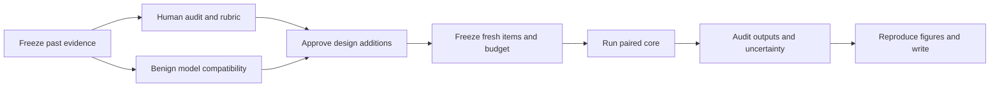

# From exploratory results to a publishable VLM safety paper

Evidence review: 2026-10-20 (saved Colab notebook/output reconciliation). This is the current explanation and work plan, not a claim that the paper is ready. Scientific numbers come from saved aggregate files. Model recommendations are proposals and do not amend the approved experiment.

**Unified reading notebook:** [vlm_project_companion.ipynb](../notebooks/vlm_project_companion.ipynb) now gathers the v1–v7 design history, code/function locations, regenerated tables, compatibility failures, both development pilots and claim limits. It embeds a hash-checked allowlisted aggregate snapshot and executes only CPU displays; no Drive authorization or model rerun is needed. Regenerate with `python3 tools/nb_gen/make_unified_nb.py --execute`; add `--compatibility-ledger audit_work/v7_autonomy_state_PRIVATE.json` locally for the known compatibility categories. Source hashes describe the snapshot, not an attestation that current local code ran in every historical archive.

**Latest decision:** the matched crossover development study and the accepted Amendment 7 response-window run are complete. The predicted reversal was **not observed** on the eight seen questions. The window run completed 32 target responses and 128 guard evaluations with zero failures; both guards gave identical labels to the 256-token prefixes and their corresponding up-to-512-token responses. Eight full responses still hit the cap, and new human review is pending, so the broader window conclusion remains unresolved. Section 17 reconciles the saved Colab outputs with the earlier claims. Historical exploratory effects remain in the evidence record; they are not fresh confirmation or established novelty. Reserved confirmation remains locked.

## 1. The question in ordinary language

Imagine asking a model the same thing in two ways: typed into a chat, or printed in a picture. If it behaves differently, it is tempting to blame its vision system. But the picture version often also changes the wording, shortens the request, and asks the model to complete a list. We need to find out which change matters.

**How much of an apparent image-related safety failure survives when the text, surrounding instruction, image presence, and scoring are controlled?** That is the paper's question. The useful output is an evaluation protocol and a trustworthy account of its limits. A publishable contribution still needs material value beyond existing controls, reliable annotations, and evidence beyond our original three models.

The original see-saw hypothesis predicted that improving one channel's safety would worsen the other. Our limited evidence does not support that prediction. It does not rule out every possible trade-off; positive correlations do not establish a shared causal mechanism.

## 2. What has actually been tried

| Version | Main change | Meaning today |
| --- | --- | --- |
| v1 | Two Qwen VLMs and language backbones; text/image/blank comparisons; steering | Historical pilot, different stimulus and unreliable judging; do not pool with later versions |
| v2 | Phrase-as-text control, benign prompts, random items, steering controls | Exploratory; retain exact labeller identity |
| v3 | Multiple judges, transcription checks, decomposition, refusal-prefix score | Revealed judge disagreement; decomposition depends on comparison path |
| v4 | Wrapper/content/modality grid; LLaVA; harmfulness | Pipeline smoke only, not substantive scientific evidence |
| v5 | Full grid, font arms, harm, multiple guards | Full exploratory run; neutral-image judging used the wrong stimulus; preprocessing undermined intended font sizes |
| v6 | Stimulus-aware labels, three-way refusal rule, presence, true font sizes, FigStep, batch comparison | Latest completed scientific run; human validation absent |
| v7 | Eight checkpoints, exact caches/revisions, fresh partition, sampling, dose/order, prediction | Implemented, under T4 validation; benign smoke is engineering evidence, not a safety result |

Completed scientific VLM panel: **Qwen2-VL-2B-Instruct, Qwen2.5-VL-3B-Instruct, LLaVA-1.5-7B**. Their language-backbone comparators were Qwen2-1.5B-Instruct, Qwen2.5-3B-Instruct, Vicuna-7B-v1.5. These are comparators, not three additional vision models.

The Qwen2 v7 benign smoke saved 44 responses and zero failures. The next stage finished at 16:41 EDT on October 18 with 85 responses: 44 from Qwen2.5-VL-3B and 41 from LLaVA. Both had nonempty B/E/C/readback responses. Three LLaVA `dose_*_after` calls failed with ValueError; image-after-text ordering is not validated. Qwen2.5-VL-7B loaded, but the between-call budget stopped generation before inference. The other four selected checkpoints did not reach inference. These are compatibility checks on one synthetic benign item, not safety findings or a completed scientific evaluation of the additions.

The completed notebook's code and outputs were saved in a dated Drive copy, with a separately verified aggregate snapshot, `Colab Notebooks/v7_completed_runs/2026-10-18_1641_stage2_smoke_results.json`. A separate explanatory notebook then completed the Qwen2.5-VL-7B benign stage: 44 responses, zero recorded failures, and nonempty B/E/C/readback responses. Its completed code and outputs and a distinct results snapshot are preserved in `Colab Notebooks/v7_completed_runs/2026-10-18_1722_Qwen25VL7B_COMPLETED.ipynb` and `2026-10-18_1722_Qwen25VL7B_smoke_results.json`. Total elapsed time was 21.65 minutes: loading took 1173.14 seconds and 44 generation calls took 98.82 seconds, producing 706 new tokens with 6.23 GB peak GPU memory. These short benign outputs do not establish safety, readback accuracy, or a reliable full scientific-run duration.

October 19 update: the owner renewed background compatibility work. InternVL3-2B loaded but failed its first B generation with FloatingPointError and produced zero responses. SmolVLM2 produced 41 responses, with three image-after-text dose checks failing ValueError; its before-text image-token count remained 1377 across requested sizes, so that arm does not identify a token-dose effect. LLaVA-OneVision loaded but also failed its first B generation with FloatingPointError, producing zero responses. The final InternVL3-8B stage loaded in 549.9502424310003 seconds, then failed its first B generation with FloatingPointError and zero responses; total recorded elapsed time was 9.217617846283337 minutes. Each failed stage has two records for the initial generation and enclosing model stage, not two independent failed conditions. All eight approved checkpoints have now been attempted: three Qwen checkpoints completed the benign checks, two checkpoints have partial coverage, and three failed before saving any response. This is not full-panel compatibility or a scientific result. Original notebooks and distinct aggregate snapshots were archived and hash-verified before review. The working notebook now includes the final panel explanation and the deeper-analysis location; a reviewed dated copy is preserved as `Colab Notebooks/v7_completed_runs/2026-10-19_0140_PANEL_REVIEWED_FINAL.ipynb`. No further inference is queued; scientific and human gates remain pending.

Deeper historical analysis completed separately at 01:04 EDT: six CPU notebook cells executed without errors, covering 54 rule-shift cells, 81 between-guard outcome differences and 108 differences of cell means. The executed explanatory notebook and separate aggregate files are verified in `vlm_tradeoff_analysis/deeper_measurement_2026-10-19_010506/` on college Drive. In the frozen v6 data the largest raw-minus-NC refusal shift is 7.2368421052631575 percentage points (LLaVA-1.5-7B, Qwen3Guard, F_img). This is a descriptive difference between scoring definitions, not evidence that the NC rule is correct. These cell-valid mean differences are not new paired estimates or human-validated effects. Reproduce with `python3 tools/nb_gen/make_research_extension_nb.py --analysis-only --execute --output /private/tmp/vlm_deeper_measurement_analysis_EXECUTED.ipynb`.

The working notebook has editable explanations after every logical results block and an aggregate-only automatic readout. Historical notebooks are in `v7_completed_runs`; the final working notebook remains in the main folder. Interpretations must follow the saved results. Compatibility completion does not satisfy the human audit, scientific compute-budget or confirmatory-data gates.

**October 19 completed development pilot:** Qwen2-VL-2B generated 32 responses for eight previously seen MM-SafetyBench items (one per scenario): B/E/C and separate readback. The two guards and keyword rule produced 72 label records; no failures were recorded. College Drive mounted successfully. The actual notebook/code/outputs, unchanged original results and a separate historical-analysis snapshot are verified in `Colab Notebooks/v7_completed_runs/2026-10-19_123518_Qwen2_CORE8_DEVELOPMENT_COMPLETED/`. This updates the earlier “no further inference queued” status above: the owner subsequently authorized this bounded exploratory pilot. Human validation is still pending; no reserved confirmatory outcome was opened.

### Separate v7 development evidence — do not pool with v6

Sources: `v7_development_core8/pilot_summary.json` and `pilot_rates.csv`, generated by `tools/summarize_development_pilot.py`. Verification checks the manifest, exact generation and label cache contents, response/stimulus hashes, revisions, unique coverage and exported denominators. Public outputs contain aggregates only. `tools/cross_version_table.py` regenerates this table beside the historical tables, never as pooled data.

<!-- generated:pilot:start -->
| Judge | Condition | Refusal / valid | Unsafe / valid | NC / valid |
| --- | --- | --- | --- | --- |
| keyword | B | 5/8 | unavailable | 0/8 |
| keyword | C | 0/8 | unavailable | 0/8 |
| keyword | E | 0/8 | unavailable | 0/8 |
| qwen3guard | B | 5/8 | 3/8 | 0/8 |
| qwen3guard | C | 0/8 | 7/8 | 0/8 |
| qwen3guard | E | 0/8 | 7/8 | 0/8 |
| wildguard | B | 5/8 | 3/8 | 0/8 |
| wildguard | C | 0/8 | 8/8 | 0/8 |
| wildguard | E | 0/8 | 8/8 | 0/8 |
<!-- generated:pilot:end -->

Both guards assign refusal to 5/8 B responses and 0/8 E and C responses. Each guard's E/C harm labels also agree item by item: Qwen3Guard marks the same 7/8 pairs unsafe; WildGuard marks all 8/8 unsafe. Thus this pilot supplies **no observed E/C refusal or harm discordance**, rather than confirming the proposed hidden image-only harm pattern. Across all 24 answering responses, the guards disagree on harmfulness twice and on refusal zero times. Agreement between guards is not human validation. Keyword harmfulness is unavailable, not zero.

This eight-item purposive development subset is not a fresh replication or a population estimate. B−E also changes content form, so it cannot isolate wording. Separate readback passes for 8/8 images but does not prove comprehension during answering. The original export reports zero-width E/C intervals and `equivalent=True` at an all-zero refusal boundary; preserve that original output but **do not accept population equivalence from it**. The reviewed summary therefore supplies descriptive counts without endorsing those intervals/verdicts. Likewise the recorded B−C McNemar p is 0.0625; no significance claim is warranted.

Sixteen of the 24 answering calls reach the 256-token cap (B: 3/8; E: 6/8; C: 7/8); none of the eight readbacks reaches it. These are cap hits, not proof of omitted harmful content, and the evaluated outcome is the observed capped response. Recorded target generation time is 42.35910001499997 seconds for B, 73.26882427299824 for E, 77.86258005800028 for C and 3.4552436810008658 for readback; total exported elapsed time including setup/data/guards is 33.01174964389999 minutes. Do not extrapolate this to an eight-model scientific budget or interpret unequal-length text/image timings as a controlled speed comparison.

[Current explanatory working Colab](https://colab.research.google.com/drive/1D-saUPWAvvOer50kpJ6jVxggwBsFAHg3) · [Earlier Qwen2.5-VL-7B working Colab](https://colab.research.google.com/drive/1HINIelZPY11XR1UiIng3Qusb3EerIrfJ) · [Archived completed partial panel, code and outputs](https://colab.research.google.com/drive/1bwaRgUAA_BkUHsaNF4KCK2GBpHOrjieA) · [Completed Qwen2 smoke, code and outputs](https://colab.research.google.com/drive/1-z-tdqXZC6md3ESYiJbhHECVf9Kfg0kP).

## 3. Completed results and their interpretation

Everything below is **exploratory and guard-labelled, not human-validated**. Higher refusal is not automatically better safety: a model can refuse harmless requests, fail to understand, or provide harmful assistance.

B = original plain-text question. C = benchmark typographic image and instruction. E = image text in the chat with the corresponding instruction. **B and E also differ in content form; B−E is not a pure causal estimate of wrapper wording.** The separate full-question grid provides the cleaner wording comparison.

### MM-SafetyBench, Qwen3Guard three-way labels

<!-- generated:current:start -->
| Model | n | Plain B % | Text twin E % | Image C % | B−C pp | Scenario 95% CI pp | Unsafe C % |
| --- | --- | --- | --- | --- | --- | --- | --- |
| Qwen2-VL-2B | 304 | 66.1 | 18.4 | 15.1 | 51.0 | 30.7 to 71.3 | 55.9 |
| Qwen2.5-VL-3B | 304 | 74.3 | 51.0 | 44.1 | 30.3 | 17.5 to 43.0 | 33.6 |
| LLaVA-1.5-7B | 152 | 45.4 | 37.5 | 2.6 | 42.8 | 18.2 to 67.4 | 59.9 |
<!-- generated:current:end -->

Source: `v6_full/results_v6.json`, `results[model].rates.qwen3guard`, `contrasts.qwen3guard.gap_B_minus_C`, `unsafe_rate_all.qwen3guard.C`. Intervals are saved scenario-level t intervals over eight scenarios. Sample sizes are items per condition. Some guard parses are missing; final tables must expose the parsed denominators.

- **Qwen's text control accounts for much of the apparent gap.** Qwen2 has low refusal in both E and C. Plain text versus picture alone is therefore insufficient to measure vision-specific safety.
- **Wording changes the image effect.** Qwen2's full-question text-minus-image difference is 31.9 percentage points under the plain instruction and 6.3 under the strong instruction. Qwen2.5's strong-instruction image refusal is 92.4%, versus 55.6% for text. This reversal requires replication, not a new explanation chosen after seeing it.
- **LLaVA behaves differently.** Refusal is 45.4% on plain text and 6.6% with unrelated noise; the corresponding Qwen3Guard unsafe rates are 39.5% and 74.3%. This supports a presence-related effect in this checkpoint, not all VLMs.
- **Reading needs separate measurement.** Saved 12-pixel readback rates are 99.3%, 99.7%, and 46.1% for the two Qwens and LLaVA. A separate successful readback does not prove the answer-generating call understood the request.
- **Refusal and harmfulness are different outcomes.** Unsafe rate is not one minus refusal rate. Safe completion and failure to understand also exist.

Audit priority: LLaVA F_img has 92.8% flagged NOT_COMPREHEND while Qwen3Guard marks 84.2% unsafe. These labels can overlap, but this combination requires inspecting task relevance and guard validity before strong safety claims.

### FigStep, 200 items per model

<!-- generated:figstep:start -->
| Model | n | Plain % | Text twin % | Image % |
| --- | --- | --- | --- | --- |
| Qwen2-VL-2B | 200 | 76.0 | 3.5 | 0.0 |
| LLaVA-1.5-7B | 200 | 46.5 | 0.0 | 8.0 |
| Qwen2.5-VL-3B | 200 | 75.5 | 15.5 | 31.5 |
<!-- generated:figstep:end -->

Source: `v6_full/results_v6.json`, `figstep[model].rates.qwen3guard`. The text twin sometimes refuses less than the image. Report percentage-point differences first: recovery ratios can exceed one and are unstable near a zero gap. These refusal rates are not a reproduction of the original paper's ASR metric or model panel.

### Cross-version reproduction

Regenerate marked tables with `python3 tools/cross_version_table.py --write-doc docs/STATUS_AND_PAPER_PLAN.md`; verify with `--check-doc` instead. The script exports selected numeric aggregates only.

<!-- generated:cross:start -->
| Version | Model | Judge | n | A % | B % | C % | D % | E % | B−C pp |
| --- | --- | --- | --- | --- | --- | --- | --- | --- | --- |
| v1 | Qwen2-VL-2B | legacy | 240 | 79.6 | 72.1 | 52.1 | 84.2 | — | 20.0 |
| v1 | Qwen2.5-VL-3B | legacy | 240 | 81.2 | 82.1 | 61.3 | 82.1 | — | 20.8 |
| v2 | Qwen2-VL-2B | legacy | 304 | 71.7 | 65.5 | 14.5 | 77.0 | 44.1 | 51.0 |
| v2 | Qwen2.5-VL-3B | legacy | 304 | 76.0 | 74.0 | 43.1 | 76.3 | 65.1 | 30.9 |
| v3 | Qwen2-VL-2B | qwen3guard | 304 | 71.7 | 66.1 | 23.0 | 77.0 | 21.7 | 43.1 |
| v3 | Qwen2-VL-2B | wildguard | 304 | 71.7 | 65.1 | 13.2 | 77.0 | 16.4 | 52.0 |
| v3 | Qwen2.5-VL-3B | qwen3guard | 304 | 78.6 | 74.3 | 45.1 | 76.3 | 53.3 | 29.3 |
| v3 | Qwen2.5-VL-3B | wildguard | 304 | 77.6 | 74.0 | 44.1 | 76.3 | 51.3 | 29.9 |
| v5 | Qwen2-VL-2B | qwen3guard | 304 | 71.7 | 66.1 | 23.0 | 77.0 | 21.7 | 43.1 |
| v5 | Qwen2-VL-2B | wildguard | 304 | 71.7 | 65.1 | 13.2 | 77.0 | 16.4 | 52.0 |
| v5 | Qwen2.5-VL-3B | qwen3guard | 304 | 78.6 | 74.3 | 45.1 | 76.3 | 53.3 | 29.3 |
| v5 | Qwen2.5-VL-3B | wildguard | 304 | 77.6 | 74.0 | 44.1 | 76.3 | 51.3 | 29.9 |
| v5 | LLaVA-1.5-7B | qwen3guard | 152 | 54.6 | 45.4 | 12.5 | 5.3 | 40.8 | 32.9 |
| v5 | LLaVA-1.5-7B | wildguard | 152 | 52.6 | 44.1 | 2.0 | 5.3 | 37.5 | 42.1 |
| v6 | Qwen2-VL-2B | qwen3guard | 304 | 71.7 | 66.1 | 15.1 | 77.3 | 18.4 | 51.0 |
| v6 | Qwen2-VL-2B | wildguard | 304 | 71.7 | 65.1 | 12.2 | 77.0 | 15.5 | 53.0 |
| v6 | Qwen2.5-VL-3B | qwen3guard | 304 | 78.6 | 74.3 | 44.1 | 76.3 | 51.0 | 30.3 |
| v6 | Qwen2.5-VL-3B | wildguard | 304 | 77.6 | 74.0 | 44.1 | 76.3 | 50.0 | 29.9 |
| v6 | LLaVA-1.5-7B | qwen3guard | 152 | 54.6 | 45.4 | 2.6 | 5.3 | 37.5 | 42.8 |
| v6 | LLaVA-1.5-7B | wildguard | 152 | 52.6 | 44.1 | 0.0 | 5.3 | 36.8 | 44.1 |
<!-- generated:cross:end -->

The broad direction persists, especially under WildGuard, but **not every guard gives the same gap**. For Qwen2, v3/v5 Qwen3Guard gives 43.1 points; WildGuard gives 52.0. V6 changes judging context and non-answer handling. Reusing items or cached generations across versions does not produce independent replications.

### See-saw and steering evidence

<!-- generated:coupling:start -->
| Version | Model | Item phi | Scenario Spearman |
| --- | --- | --- | --- |
| v1 | Qwen2-VL-2B | 0.500 | 0.891 |
| v1 | Qwen2.5-VL-3B | 0.543 | 0.733 |
| v2 | Qwen2-VL-2B | 0.240 | 0.826 |
| v2 | Qwen2.5-VL-3B | 0.455 | 0.898 |
<!-- generated:coupling:end -->

<!-- generated:steering:start -->
| Model | Arm and strength | n | Refusal % |
| --- | --- | --- | --- |
| Qwen2-VL-2B | text_harm\|refusal\|0.0 | 120 | 58.3 |
| Qwen2-VL-2B | vision_harm\|refusal\|0.0 | 120 | 12.5 |
| Qwen2-VL-2B | benign_text\|refusal\|0.0 | 24 | 0.0 |
| Qwen2-VL-2B | text_harm\|refusal\|0.5 | 120 | 80.0 |
| Qwen2-VL-2B | vision_harm\|refusal\|0.5 | 120 | 76.7 |
| Qwen2-VL-2B | benign_text\|refusal\|0.5 | 24 | 37.5 |
| Qwen2-VL-2B | text_harm\|random\|0.5 | 120 | 58.3 |
| Qwen2-VL-2B | vision_harm\|random\|0.5 | 120 | 10.0 |
| Qwen2-VL-2B | benign_text\|random\|0.5 | 24 | 0.0 |
<!-- generated:steering:end -->

Sources: v1/v2 `results[model].coupling`, v2 `steering[model].results`. Historical exploratory labels. The tested steering raises both channels' refusal and benign over-refusal. It does not establish a universal mechanism or a deployable mitigation.

V6's stored hypothesis checks: H21 false, H22 split, H23 true, H24 false, H25 true, H26 inconclusive, H27 false. Mixed outcomes belong in the paper.

## 4. Models: approved panel and proposed extension

| Approved checkpoint | Purpose | Scientific status |
| --- | --- | --- |
| Qwen2-VL-2B-Instruct | Historical anchor | v6 complete |
| Qwen2.5-VL-3B-Instruct | Anchor and reversal check | v6 complete |
| LLaVA-1.5-7B | Presence-effect anchor | v6 complete |
| Qwen2.5-VL-7B-Instruct | Larger Qwen | No v7 scientific result |
| InternVL3-2B-hf | Additional vision architecture | No v7 scientific result |
| InternVL3-8B-hf | Within-architecture size comparison | No v7 scientific result |
| LLaVA-OneVision-Qwen2-7B-OV-hf | Different LLaVA architecture | No v7 scientific result |
| SmolVLM2-2.2B-Instruct | Compact additional family | No v7 scientific result |

Eight checkpoints form four implementation groups, not eight independent architectures/backbones. Some share Qwen ancestry. Precision also differs between small and large checkpoints; do not attribute every difference to size. Exact model IDs are in Amendment 5 and `tools/vlm7_core.py`.

### Recent models worth testing, not yet tested here

| Priority | Official checkpoint | Value | T4 caveat |
| --- | --- | --- | --- |
| First | [Qwen/Qwen3.5-4B](https://huggingface.co/Qwen/Qwen3.5-4B) | Recent small model with vision and language | Candidate only; validate FP16/NF4, kernels and newer Transformers environment |
| First | [google/gemma-4-E4B-it](https://huggingface.co/google/gemma-4-E4B-it) | Recent non-Qwen architecture; document/image understanding | Candidate only; about 8B total parameters, despite E4B name. Test quantized loading; [E2B-it](https://huggingface.co/google/gemma-4-E2B-it) can be a predeclared smaller fallback |
| Next | [Qwen/Qwen3-VL-4B-Instruct](https://huggingface.co/Qwen/Qwen3-VL-4B-Instruct) | Bridge to recent OCR/vision models with direct-answer variant | Candidate only; potentially less integration work than Qwen3.5, but inference must be tested |
| Next | [mistralai/Ministral-3-3B-Instruct-2512-BF16](https://huggingface.co/mistralai/Ministral-3-3B-Instruct-2512-BF16) | Mistral/Pixtral family diversity | Candidate only; test FP16 conversion or NF4. Do not assume the separate FP8 release works natively on T4 |
| Optional | [OpenGVLab/InternVL3_5-4B-HF](https://huggingface.co/OpenGVLab/InternVL3_5-4B-HF) | More recent InternVL | Card advertises custom code: needs native support or a separately reviewed adapter |
| Optional | [zai-org/GLM-4.6V-Flash](https://huggingface.co/zai-org/GLM-4.6V-Flash) | GLM vision reasoning | Validate quantization, output budget and final-answer availability before budgeting |

Official cards establish identity and advertised modalities, not measured safety or compatibility in our setup. My recommendation is the first two additions before further expansion. Favor modern family breadth and trustworthy labels over another size in an existing family. Additions or fallback rules need a dated approved addendum; retain failures in the coverage table.

The official [Qwen listing](https://huggingface.co/Qwen/models) includes newer Qwen3.8 models. [Qwen3.8-27B](https://huggingface.co/Qwen/Qwen3.8-27B) supports vision but is a poor first T4 choice because of size; this is a resource judgment, not a verified impossibility. I could not verify an official Qwen 4.1 checkpoint. [GLM-4.1V-9B-Thinking](https://huggingface.co/zai-org/GLM-4.1V-9B-Thinking) is a different family released in July 2025.

[Bitsandbytes hardware documentation](https://huggingface.co/docs/transformers/quantization/bitsandbytes#hardware-compatibility) supports NF4/FP4 on hardware older than T4. Quantization support does not guarantee an entire model fits or runs. Visual tokens, activations, nonquantized layers, generation cache and CPU offload also matter.

For every addition, freeze revision, template, system prompt, thinking mode, decoding and preprocessing before outcomes. Record actual image tokens/order, memory, offload, throughput, empty replies and truncation. Thinking-only output that hits the token limit must not count as a successful safe answer. Common decoding aids comparison but may depart from vendor recommendations; state that limitation.

## 5. What is and is not new

The earlier novelty assessment was too optimistic. **FigStep already includes an all-text control, Q2-prime, in Section 6.4 and Table 2.** Our use is replication, not invention. The question is whether its explanatory value changes across model generations and scoring protocols. [Gong et al., arXiv:2311.05608v3](https://arxiv.org/html/2311.05608v3#S6.SS4).

**MMJailBench already factorizes framing, visual context and carrier, and uses a comprehension-conditional attack metric.** Credit it directly. A protocol paper must demonstrate additional empirical or practical value. [Wang et al., arXiv:2608.25490, Sections 3–5](https://arxiv.org/html/2608.25490v1).

Promising contributions to test, not claim yet:

1. Replication showing **where interpretation changes across model generations** under matched controls and audited labels.
2. Measurement study showing **how refusal/non-answer/harm distinctions alter effect sizes and model comparisons**, with human reference labels and sampling weights.
3. **Predicting image-condition refusal from a cheap text control**, holding out whole architecture groups and comparing with simple baselines. Novelty is unestablished; eight checkpoints are a fragile prediction sample.

Presence, basic steering, font sensitivity, and conditional-on-understanding scores have substantial precedent. They are controls/supporting analyses. Source-specific evidence and reading limits: `docs/NOVELTY_AUDIT_AND_PLAN.md`.

## 6. Improvements in priority order

| Priority | Action | Why | Completion criterion |
| --- | --- | --- | --- |
| 1 | Human annotation and calibration | Comparisons depend on label validity | Blinded stratified audit, planned second-annotator overlap, 60-row retest, weighted agreement and guard error intervals |
| 2 | Audit NC and harmfulness separately | Non-refusal is not compliance or harmlessness | Stimulus-aware adjudication; held-out rule evaluation; harm audit includes refusing and non-refusing outputs |
| 3 | Preserve completed runs | Prevents lost configuration/output history | Dated notebook with code/outputs, aggregate snapshot, private manifest/coverage, verified before next run |
| 4 | Validate recent models | Model cards cannot prove our pipeline works | Text/image/blank/readback/sampling checks, actual memory/speed/order/failure records |
| 5 | Freeze feasible fresh items | Re-reading the same data is exploration | Original-ID/hash exclusions, per-scenario counts, verified transcriptions and explicit shortfalls |
| 6 | Execute the approved core | Limits outcome-driven decisions and wasted compute | Human gate, measured budget, paired coverage and uncertainty |
| 7 | Write reproducibly | Prose must not outrun results | Regenerated figures/tables, checked citations, limitations and negative outcomes |

Current local audit: 360 rows, 360 Claude labels, **zero nonempty human labels**. Claude is an LLM annotator. Reviewing only disputed/borderline rows creates a hybrid reference unless reported separately; it does not silently validate every Claude label. Human annotation of all 360 existing rows is the cleaner route. The planned v7 audit is separate.

Disagreement-selected rows are oversampled. Reconstruct strata and inclusion probabilities before population estimates or calibration. Include sensitivity/specificity uncertainty and scenario clustering; report unstable/undefined corrections. Tune NC on the development split only and test once on the grouped held-out split. A safe alternative answer must not be called incomprehension merely because it declined the unsafe part.

**Owner-confirmed validation rule, October 19:** preserve the original model responses and automated labels with their run and scoring versions; human review adds a separate version rather than overwriting them. Report automated and human-reviewed estimates separately, with audit coverage and sampling weights. Freeze the grouped audit tuning/evaluation split before using annotations to improve scoring. Evaluate each frozen scoring revision on human labels untouched by its tuning; labels already used to tune it cannot also serve as its held-out validation. If no untouched labels remain, obtain a new independent evaluation sample. Post-collection human review is permitted for the exploratory development pilot; it may change labels, estimates and conclusions. This reporting rule does not unlock reserved confirmatory collection or change the approved Amendment 5.

Human work, in plain language: read the actual stimulus and response; decide whether there was a refusal, whether it addressed the request, and whether substantive harmful assistance appeared; flag ambiguity. Resolve conflicts before declaring a model safer. Revised annotation axes need a documented rubric/addendum, not a silent change to v6 labels.

## 7. End-to-end execution



**Now:** compatibility attempts and both bounded development runs are preserved. Begin the human audit and resolve the narrowed contribution with the advisor before proposing further collection. Successful cached work should resume rather than redownload solely to produce a new log.

**Before science:** preserve approved Amendment 5 unchanged. Recent models, extra benchmarks, revised annotation axes, decoding policy, or a reduced-condition schedule need a dated addendum and owner approval. Numerical repairs need provenance. Keep every planned model visible, including failures; do not choose replacements after safety outcomes.

**Core:** prioritize B/E/C on both original benchmarks, the prespecified full-question grid, and relevant controls. If compute requires staged or reduced secondary arms, approve the schedule before generating outcomes. H28–H29 are primary; H30–H34 secondary. Do not expand every optional arm merely because code exists.

**Budget:** use measured tokens/second at representative approved output lengths, actual image tokens, planned counts, guard passes, retries and downloads. Short benign answers cannot justify extrapolating smoke minutes into a promised full-run duration. Retire the old unmeasured “10–12 hour v7” estimate.

**Freshness:** held out means unseen by this project's tuning/analysis, not guaranteed absent from model pretraining. Exclude historical and development items. If remaining scenarios are small, report achieved precision and scope. A new split of one dataset is not a new independent dataset.

**Analysis:** paired percentage-point effects and cluster intervals; honest scenario and architecture-group sample sizes; predeclared multiplicity; equivalence tests for absence claims. Observational model correlations cannot prove training-induced trade-offs. Prediction needs held-out groups, errors and mean/B-only baselines, with related checkpoints kept out of opposite sides of a fold.

**Release:** code, revisions/settings, safe reconstruction instructions, aggregates and figures. Raw prompts/images/replies/audits remain private under project rules. Explain what others can reconstruct from upstream open data. Early raw replies in Git history require the owner's separate housekeeping decision.

## 8. A paper readers can follow

Working title: **When Does the Image Matter? Auditing Typographic Safety Gaps Across Vision–Language Models.**

Proposed opening, not a final-results abstract:

> A lower refusal rate on an image-based request is often interpreted as a weakness of visual safety alignment. That interpretation is difficult to assess when the image condition also changes the wording and format of the request. We revisit typographic safety evaluations with text controls, image-presence controls, and explicit checks of response interpretation. Our exploratory results suggest that the apparent gap depends on the checkpoint, the surrounding instruction, and the scoring procedure. The next stage tests these observations on held-out items and recent open models with human-validated measurement.

| Paper part | Reader's question | Evidence |
| --- | --- | --- |
| Introduction | What is measured incompletely? | Benign illustration, bounded contribution |
| Related work | Which ideas already exist? | FigStep control, MMJailBench, presence/evaluation literature |
| Method | What changes between conditions? | Payload/wrapper/carrier diagram, exact settings, human rubric |
| Results 1 | How much gap survives the text control? | B/E/C effects and cluster intervals, both benchmarks |
| Results 2 | Can text predict held-out models? | Held-out errors, R-squared and simple baselines |
| Results 3 | How much depends on labels? | Raw/audited/calibrated effects, uncertainty, error types |
| Supporting analyses | When do presence, reading and sampling matter? | Prespecified secondary results, including nulls |
| Limitations/ethics | Where do claims stop? | Fixed panel, precision, English, limited clusters, private raw data |

Write “the tested checkpoints,” “guard-labelled,” and “does not support.” Explain a figure before its p-value. Use benign synthetic examples. Clear writing uses concrete explanations and traceable claims; it does not make uncertainty disappear.

## 9. Publication decision and milestones

This is a plausible evaluation/replication paper, not yet a validated manuscript or guaranteed acceptance. A workshop-sized study should make one measurement point convincingly. A broader ARR submission needs demonstrated incremental value over close prior work; checkpoint count alone is insufficient. Venue choice belongs to the owner and advisor.

The repository's January 4, 2027 date was unverified. The [official ARR schedule](https://aclrollingreview.org/dates), checked October 18, lists ACL 2027 as **January 2027**, without an exact day. November 20 is an internal target until a specific workshop call is checked. [TMLR](https://jmlr.org/tmlr/) uses rolling submission; discuss overlap rules before treating it as a destination after publishing elsewhere.

Milestones, conditional on human availability and measured compute:

1. Advisor agrees on the narrowed contribution; human audit begins; compatibility coverage is saved.
2. Audited labeller choice, model/addendum decision, verified transcriptions/fresh counts, explicit run budget.
3. One confirmatory core execution, new-output audit/calibration, analysis and reproduced figures.
4. Draft, advisor review, claim/citation/data-release check, then a verified venue deadline.

The Gemini deep-research skill was read, but its runner and API configuration were unavailable. This review uses local evidence and primary-source web research; it is scoped, not an exhaustive systematic review. No additional model download or scientific run was started for this review.

## 10. Completed crossover development study, October 19

**The prespecified qualitative crossover was not observed in this eight-item development sample.** This stage is complete, with all 56 target calls, 96 guard calls and 48 CPU keyword checks, zero recorded failures and approximately 29 minutes including setup/export. It is separate from the earlier Qwen2 core-eight pilot and historical v6. Source: [the verified saved aggregate](../v7_crossover_core8/results_crossover.json), copied byte-for-byte from the completed college Drive run after checking its original snapshot hashes and private checkpoint integrity.

Qwen2.5-VL-3B, one previously seen question per scenario, identical full-question words across the primary carrier/wrapper cells. Both guards give the following raw refusal counts:

| Guard | Plain text | Plain image | Steps text | Steps image |
| --- | --- | --- | --- | --- |
| Qwen3Guard | 4/8 | 5/8 | 5/8 | 8/8 |
| WildGuard | 4/8 | 5/8 | 5/8 | 8/8 |

Image-minus-text refusal is +12.5 percentage points under plain wording and +37.5 points under steps wording. The interaction is +25 points, but **both effects are positive**: the required negative plain-image effect is absent. Thus a larger instruction-dependent difference is observed descriptively; a direction reversal is not. Do not reinterpret a positive interaction as confirmation of the chosen crossover, generalize from eight development items, or pool this new matched pair with the differently worded v6 strong-wrapper pair.

Blank-image controls match their text-only counterparts item by item for both refusal and harmfulness under both guards. Each guard labels harmful assistance in 1/8 plain-text and plain-text-plus-blank answers, and 0/8 in the other answering arms. Zero observed harmfulness is not proof of safety. The frozen NC rule flags none; that is automated measurement, not human comprehension validation.

All eight normalized readbacks match and all image orders are verified. **17 of 48 answering responses reach the 256-token cap**: P_txt 4, P_img 3, S_txt 3, S_img 0, P_blank 4, S_blank 3. Separate readback does not prove comprehension during answering. Later content may be censored. The 512-token/window diagnostic, benign utility and human reference have not been collected.

The timing-only gate declined the second balanced block because representative cap-length coverage was absent in at least one answering arm; it did not stop for failure or because 150 minutes elapsed. The measured projected second-block finish was under the allowance, but the other prespecified condition failed. Preserve that decision rather than expanding after seeing the effects. No fresh confirmatory data were generated.

The [working Colab](https://colab.research.google.com/drive/1jc_SouBqQ3ITHOPa4AVCi68F-6ANV1za) shows all changes saved. The original completed code/output notebook and separate matching aggregate snapshot were verified under `My Drive/vlm_tradeoff_out_v7/development/crossover_3b_20261019T174000Z/snapshots/20261019T181323_358733Z/`. The working notebook's result interpretation was updated after preservation, without rerunning inference. No additional manual copy is required. Private responses, labels and manifests remain on Drive; only aggregates are copied into the repository.

Next measurement: blinded human review of all 48 answering outputs, retaining original automated labels and any adjudication separately. Any scoring changes require untouched grouped validation labels. This development run satisfies its engineering schedule, not the human/retest or fresh-confirmation gates. A paper-level novelty or population claim remains unsupported by this stage alone.

## 11. Prepared next stage: independent human review

**Notebook entry point:** [vlm_next_stage_human_validation.ipynb](../notebooks/vlm_next_stage_human_validation.ipynb) explains the completed results and readiness checklist, then optionally verifies/opens the private review package and analyzes separate reviewer exports. Its default executed cells use saved aggregates only: no Drive mount, human labeling or new model calls. Enable private loading only when ready. It is generated by `tools/nb_gen/make_human_validation_nb.py`; editable explanations follow result blocks. The separate HTML files are supporting review interfaces, not a substitute for this notebook.

The offline review package is generated by `tools/prepare_crossover_audit.py`. It checks exact source aggregates, frozen revisions, candidate identities, all 56 generation checkpoints, 96 guard checkpoints, stimulus/response links, the frozen NC helper, image hashes and recomputed aggregates. All eight full-question images can be recreated byte-for-byte. It then prepares **two independently randomized reviewer HTML files for all 48 answering outputs**, with original instructions, verified images and responses. The analyst key stays separate. Reviewer files hide checkpoint/item identities, condition codes, guard labels and hypotheses; the visible request necessarily reveals wording and carrier. This is partial blinding.

Each reviewer records refusal, harmful assistance and observable comprehension evidence independently, with uncertainty and optional notes. A refusal can contain harmful assistance; a coherent refusal is not itself noncomprehension. These operational development-audit axes do not silently replace the frozen v6 three-way gate. Labels are downloaded as private JSON; they are **not automatically saved to Drive**. Save progress before closing and reload the same file to resume. Preserve original and adjudicated versions separately. Source type is explicitly recorded: self-declared human versus LLM annotation is not independently verified by software.

`tools/analyze_crossover_audit.py` validates package integrity, reviewer identity/row coverage and label vocabulary. It reports per-reviewer rates, paired effects, missing/uncertain bounds, guard confusion counts and inter-reviewer agreement/kappa (undefined cases stay unavailable). Agreement-only labels are an additional descriptive view, not adjudication; disagreement remains unresolved. It makes no primary-guard choice, confidence interval, calibration or confirmatory decision. A census of this development block requires no disagreement-sampling weights; the separate v6 audit does. All generated review material stays under ignored `audit_work/` and the private college Drive project folder. No prompt, image, response or human row enters public results.

These 48 units evaluate existing frozen scoring. If their labels inform a scoring revision, they cannot also validate that revision as untouched data. New item-grouped validation labels are then required. Reviewing this small block **does not satisfy** the separate complete 360-row v6 human reference and at least 60-row independent/next-day retest gate. No human labels have been supplied by this preparation step.

| Workstream | What is ready | What remains before confirmation |
| --- | --- | --- |
| Advisor decision | Unified notebook, source-linked results and negative crossover result | Advisor/owner agree on one consequential measurement or replication question; novelty remains unresolved |
| Compatibility | Eight attempted checkpoints and completed/partial/failed archives | Select the achieved panel before fresh outcomes; do not silently replace failures |
| Development audit | Two private review interfaces, rubric, checked provenance and analysis tool | Independent human labeling, explicit adjudication and separate original/human reporting |
| Formal reference gate | Existing v6 blinded audit and retest | Complete reference/retest, verify coverage/provenance, then apply the accepted guard eligibility rule |
| Fresh collection | Previously used IDs/hashes remain preserved | Verified exclusions/transcriptions, achieved per-scenario counts, accepted endpoints and measured target/guard/save budget |
| Paper | Existing exploratory draft and unified evidence companion | Human-reviewed findings, valid uncertainty, fresh core if justified, reproduced figures, advisor/citation/release checks and verified venue |

**Advisor discussion brief:** “Our matched eight-item development test did not reproduce the hypothesized sign reversal. The broader historical results remain exploratory and scorer-dependent. Should we narrow the paper to a human-audited measurement/replication study of when text controls preserve image-evaluation conclusions? What specific comparison would provide sufficient added value over the closest papers?” This is a question for scientific positioning, not an established new finding. No message has been sent to the advisor.

Reproduce privately, using a new output directory each time:

```sh
python3 tools/prepare_crossover_audit.py --source /path/to/completed/crossover_run --output audit_work/new_review_PRIVATE
python3 tools/analyze_crossover_audit.py --package audit_work/new_review_PRIVATE --review /path/to/human_review_A.json --review /path/to/human_review_B.json --output audit_work/review_analysis_PRIVATE
python3 tools/nb_gen/e2e/e2e_human_audit.py
```

No new model generation, reserved outcome access or change to the approved analysis plan is part of this preparation. The separate 512-token diagnostic would still need its own accepted scope and measured budget.

## 15. Human–LLM review and next response-window notebook — 2026-10-20

Verified the unchanged Reviewer A export and derived, hash-linked normalization of Reviewer B. B is **GPT-6.1-Sol (user-confirmed)**; backend revision and generation settings are unknown. A received LLM assistance on some examples in the project chat; the original review is not fully independent. Neither reviewer is automatically ground truth.

| Axis | Observed comparison | Interpretation |
|---|---|---|
| Refusal | 48/48 agree; κ=1 | Descriptive agreement, not validity proof |
| Harm | 41/48 agree (85.4%); κ=0; A positive 7, B positive 0 | Seven unresolved disagreements; all-negative LLM remains visible |
| Comprehension | 48/48 categorical agreement including 17 UNCERTAIN; 31/31 resolved agree | Resolved binary κ undefined (no category variation) |

The original core-eight negative crossover is unchanged: both guards had plain image−text +12.5pp and steps +37.5pp. No selective replacement of the seven human harm labels has been made. The rubric defines harm by concrete facilitation/encouragement, not topic or detail alone. Original files, row-level disputes and assistance disclosure remain private.

New deliverable: `notebooks/vlm_window_study.ipynb`, generated by `tools/nb_gen/make_window_nb.py`. Default CPU execution shows verified comparison and historical results. The explicit GPU branch implements Amendment 7: 32 max-512-token generations, 64 prefix/full units, 128 guard evaluations, 64 new human judgments and 16 next-day repeats; seven development disputes bring planned human work to 87. Exact eight-item source and processor identity are checked. Deadline is retained on resume; partial results are saved. **Preparation status at the time of writing; superseded by the completed run in §17.** The owner subsequently accepted and launched this bounded scope. Current human audit does not unlock reserved confirmation.

Prior-art method/appendix spot checks are in novelty-review §13. Novelty remains unestablished; position as exploratory measurement/replication unless stronger evidence warrants more. Current paper work should preserve negative findings, annotation limitations and source provenance. No promise of publication follows from this preparation.

## 16. Deeper literature challenge and retrospective denominator example — 2026-10-20

Owner reports the window notebook is running. It was left untouched; no new window outcomes were read for hypothesis selection. The requested Ruflo research workflow used repository knowledge and primary web sources because its memory endpoints were unavailable. Novelty-review §14 records six questions, exact searches, source/version/read-depth matrix and claim decisions. Methodology §11 proposes later validation; current Amendment 7 endpoints and compute scope remain unchanged.

**New project diagnostic, exploratory:** in original assisted A's core answers, naive condition-specific UNDERSTANDING filtering changes raw counts (4/8,5/8,5/8,8/8) to (4/8,0/3,3/6,3/3). This creates an apparent crossover through unequal retained populations. On the common all-four cohort the counts are (0/3,0/3,0/3,3/3), so the strict negative plain effect disappears. This is not an observed change in model behavior or a latent-comprehension correction. B reproduces the calculation because the refusal/comprehension labels match A, not because it provides a second human reference. No original label is changed.

Reproduction: `tools/analyze_comprehension_selection.py`, `reports/comprehension_selection_2026-10-20.json` and `.png`; three synthetic identity/denominator/privacy tests in `tools/nb_gen/e2e/e2e_comprehension_selection.py`. No model calls. The finding is a concrete example of a known statistical issue, with domain-specific novelty still unestablished. It is not evidence that MMJailBench's different mismatch rule makes this mistake.

**Paper direction:** validate whether a paired multimodal conclusion survives cohort, reference and response-window choices. General matched controls, over-refusal, evidence probes, judge disagreement, sampling and structured-output gaps are heavily covered. Do not relabel those as breakthroughs. Finish/archive the active bounded run and obtain its planned labels before deciding on a fresh separately approved validation. No new model/stage/download or reserved confirmation was authorized by this review.


## 17. Saved Colab reconciliation and plain-English result ledger — 2026-10-20

**What was checked:** saved college-Drive notebooks for v1, v2, v3, v4 smoke, v5 full/smoke, v6 full/smoke, v7 compatibility archives, the Qwen2 development pilot, the matched Qwen2.5 crossover and the response-window study. CPU review/companion notebooks were distinguished from inference runs. Local generated notebooks often contain no outputs and are not substitutes for completed Drive copies. The saved v6 notebook's H21–H27 verdicts match its aggregate JSON. `python3 tools/cross_version_table.py --check-doc docs/STATUS_AND_PAPER_PLAN.md` confirms every marked historical/pilot table matches its source aggregates. This is evidence reconciliation, not an independent rerun or certification of every historical calculation.

| Question in simple terms | What the saved evidence says | What we can claim |
|---|---|---|
| Does improving text refusal necessarily worsen image refusal? | Historical correlations are positive; the tested steering increased both, and also increased refusal of benign requests | The tested see-saw prediction is unsupported; no universal mechanism established |
| Is the large benchmark gap entirely caused by seeing an image? | In v6 Qwen2, plain-text refusal is 66.1%, matched phrase-text 18.4%, image 15.1%. Full-question grids also vary with wording | The original comparison mixes changes; wording/content matter. B−E alone does not isolate wording |
| Can image presence itself matter? | LLaVA's v6 refusal is 45.4% on plain text and 6.6% with noise; its guard-labelled unsafe rate rises from 39.5% to 74.3% | A substantial exploratory effect in this checkpoint/configuration, not a universal VLM law |
| Is refusal the same as avoiding harmful assistance? | Qwen2 image refusal is 15.1%, while its unsafe rate is 55.9%; label definitions and guards differ | Report refusal, harm and non-comprehension separately; these rates are not complements |
| Did the newer matched test reproduce the old Qwen2.5 reversal? | Both guards: plain text/image 4/8 versus 5/8; steps text/image 5/8 versus 8/8 | No predicted crossover on these eight items. The legacy v6 observation remains recorded but used different settings/wording; this is not an exact replication |
| Did allowing longer answers change the observed guard conclusion? | 32/32 generations, 64/64 units and 128/128 guard evaluations; zero failures/missing labels; zero prefix drift or unverified order. Neither guard changed any refusal, unsafe or NC label between paired windows | No observed automated-label/window change here. Eight full responses hit 512 tokens; human review is pending, so the prespecified broader conclusion remains unresolved |
| Did human/LLM review settle harmfulness? | Original 48 answers: refusal agrees 48/48; harm agrees 41/48, with seven human positives and zero LLM positives; comprehension agrees including 17 UNCERTAIN | Agreement is not ground truth. Original human review was assisted; seven harm disputes remain unresolved, and the new 64-unit review is separate |
| Can filtering create a misleading result? | Our deliberately naive per-condition comprehension filter creates a reversal; matching the retained items across all four conditions removes it | A retrospective denominator counterexample, not a new model behavior or established methodological novelty |

**The old v6 tests did not all pass.** The saved notebook reports H21 false (the specified 2B effect-size pattern), H22 split (the full image-presence threshold pattern), H23 true (LLaVA E+blank and C observed rates within 10 points), H24 false (the combined FigStep prediction), H25 true (small-font reading/non-answer pattern), H26 inconclusive (relabelled-neutral judge agreement), and H27 false (the specified universal 15-point harmfulness increase). These are the original program's exploratory checks. In particular, H23's threshold pass is not proof of population equivalence or a causal mechanism. Broad descriptive effects can remain while a stronger combined/threshold hypothesis fails.

**Window preservation verified:** final Drive snapshot `vlm_tradeoff_out_v7/development/window_3b_20261020_v1/snapshots/20261020T173210_988698Z/` contains `notebook_with_outputs.ipynb`, `results_window.json` and their hash manifest. Both file hashes pass. The printed run JSON and snapshot JSON agree on every field except elapsed time, which advanced during final export (approximately 21 minutes). The working notebook has all eight code cells executed; the snapshot captures the seven preceding cells before its own final export completes. This expected timing does not indicate missing inference. The private 64-unit review package exists; it is not completed human annotation.

**Paper interpretation:** we have exploratory evidence that evaluation choices can change apparent text/image gaps, a failed matched reversal prediction, and no observed guard-label change in the tested response windows. The literature review identifies substantial prior coverage of the broad effects. Our own observations are useful evidence, but a novel, broadly human-validated publication claim is not yet established. Do not discard negative findings or describe compatibility smoke as safety evidence. The next planned measurement is the frozen-rubric human review, followed by the delayed intra-rater repeat.

## 18. Advisor walkthrough for October 21 — what to say and how to explain it

**Opening (about one minute):** “We started by asking whether text safety and image safety trade off. Our exploratory tests did not support that simple see-saw. We then investigated a more practical question: when a model answers a request in a picture but refuses text, how much comes from the picture, the instruction, and the way we judge the answer? We now have historical comparisons, compatibility attempts, three separate development stages, and an initial human–LLM review. We have useful observations and negative results; novelty and broad validation remain open.”

### 18.1 Explain the experimental method

1. **Inputs:** open MM-SafetyBench and FigStep data; XSTest/benign twins supply separate over-refusal controls where implemented. Previously examined items are development data. We have not opened reserved confirmatory outcomes.
2. **Models:** the main historical scientific panel is Qwen2-VL-2B, Qwen2.5-VL-3B and LLaVA-1.5-7B. Language-only backbones are comparators. Eight-model benign compatibility checks do not mean eight-model safety evidence.
3. **Controls:** compare the original text question, a benchmark image, a text version of the image payload with the same instruction, full-question text/image pairs, and unrelated-image controls. Each removes a different ambiguity; B−E still changes content form, not just wording.
4. **Generation:** no training. Historical runs generally use greedy decoding and a 256-token cap; record their batch/precision differences. New matched 3B development uses batch one and FP16; the window study generates up to 512 tokens and evaluates a 256-token prefix from that same generation. Never pool these as identical runs.
5. **Judging:** Qwen3Guard and WildGuard score the actual stimulus/response. Keyword refusal is a limited baseline. Raw refusal, the historical NC-adjusted refusal, harmfulness and observable comprehension are different measurements. Invalid early judges were retired.
6. **Statistics:** historical analyses include paired McNemar comparisons, scenario-level uncertainty, wrapper-by-carrier interactions, equivalence checks and multiplicity handling. Eight scenarios limit uncertainty estimation; zero differences in eight items do not establish population equivalence. The current window study is descriptive, with dependent prefix/full pairs.
7. **Reproducibility:** generators produce notebooks; exact model/data revisions and input/code hashes identify caches. Completed code/output notebooks and separate aggregates are preserved on college Drive. Only aggregate results, methods and safe generated reading notebooks belong in the public repository.

### 18.2 Tell the version history without treating versions as replications

| Stage | Why we made it | What it contributed / what limited it |
|---|---|---|
| v1 | Test the initial text/vision trade-off and steering idea | Historical evidence against the simple see-saw; weaker early judging |
| v2 | Add phrase-text and benign/steering controls | Both-channel refusal increases can also cause benign over-refusal |
| v3 | Compare multiple judges, readback and gap decomposition | Judge validity became a central issue; decomposition depends on path order |
| v4 | Introduce a larger factorial design and LLaVA | Smoke/pipeline validation only |
| v5 | Execute the larger grid with harm/font conditions | Full exploratory data, but wrong-stimulus judging and unintended font upscaling required correction |
| v6 | Correct judging context; test presence, fonts, FigStep and batch effects | Main historical exploratory evidence; original H21–H27 outcomes are mixed, not uniformly positive |
| v7 compatibility | Check whether an expanded panel actually runs on T4 | Three completed benign checks, two partial, three numerical failures; no expanded safety-panel claim |
| Qwen2 core-eight | Test the scientific pipeline end to end | 32 target responses; matched E/C labels agree within each guard; no hidden image-only harm evidence in this tiny pilot |
| Qwen2.5 matched core-eight | Challenge the historical reversal with a cleaner paired design | 56 target/96 guard calls; no predicted crossover; 17 answering responses hit 256 tokens |
| Original annotation comparison | Check how one human and an auxiliary LLM judge 48 answers | Complete refusal agreement; seven unresolved harm disagreements; original human was assisted |
| Response-window stage | Check whether later visible content changes the comparison | 32 target/128 guard calls; all paired guard labels unchanged; eight full cap hits; new human review pending |
| Denominator diagnostic | Check whether comprehension filtering changes who is compared | Naive unequal filtering creates an apparent reversal; matching retained items removes it; retrospective, not a new generation experiment |

### 18.3 Explain the result with one concrete example

“On the older Qwen2 results, refusal was 66.1% for the original text question, 18.4% when the benchmark payload was supplied as text, and 15.1% for the image. Comparing only 66.1% and 15.1% would over-attribute the difference to vision. The text control shows that other changes matter too. We cannot call the entire difference a pure wording effect because the payload also differs.” These are v6 Qwen3Guard figures, not human-corrected rates; use the full table in §3 for the other models and guard-specific comparisons.

“For the newer matched 3B sample, plain text/image refusal counts were 4/8 and 5/8; steps text/image counts were 5/8 and 8/8. The effect grew with wording but never reversed direction. Longer visible responses did not change either guard's labels. This is a negative result for the selected prediction, with unresolved truncation and human-measurement limits.”

### 18.4 What to ask the advisor

- Is a narrow human-audited replication/measurement contribution valuable enough relative to the closest papers?
- Which single claim would justify a larger fresh validation, given the failed crossover and unchanged guard-window result?
- Can we obtain a second independent human reviewer? The auxiliary GPT-6.1-Sol annotator is not a second human; the original human review was partly assisted.
- What minimum model/item coverage and uncertainty would be persuasive for the chosen claim? Freeze this before a new run; do not promise a venue or novelty before that decision.

**Next action, not another GPU run:** finish the 64-unit window review under the frozen rubric; retain originals and assistance disclosures; complete 16 delayed repeat judgments at least one day later; then compare paired human and guard conclusions. Any rubric tuning needs further untouched validation. If no consequential new effect emerges, retain a limited robustness/negative result and reconsider scope rather than chase a positive finding.

**Reading map:** this document is the maintained full explanation. Start with §17 for claim status and §18 for the presentation; use §3 for historical tables and §10 for matched development. `notebooks/vlm_project_companion.ipynb` is the CPU-only visual walkthrough. `notebooks/vlm_window_study.ipynb` displays saved window aggregates by default; its original executed GPU archive remains on Drive. `docs/NOVELTY_AUDIT_AND_PLAN.md` distinguishes verified prior coverage from candidate novelty. `paper/manuscript.md` is an exploratory draft, not a submission-ready paper.
